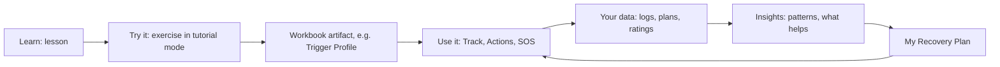
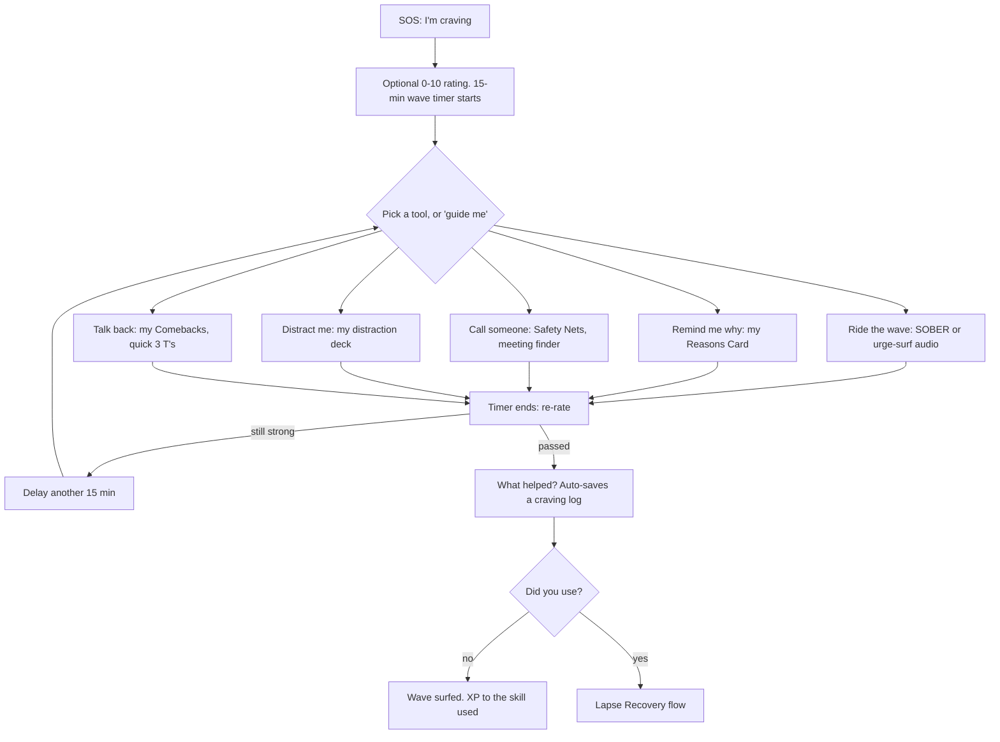
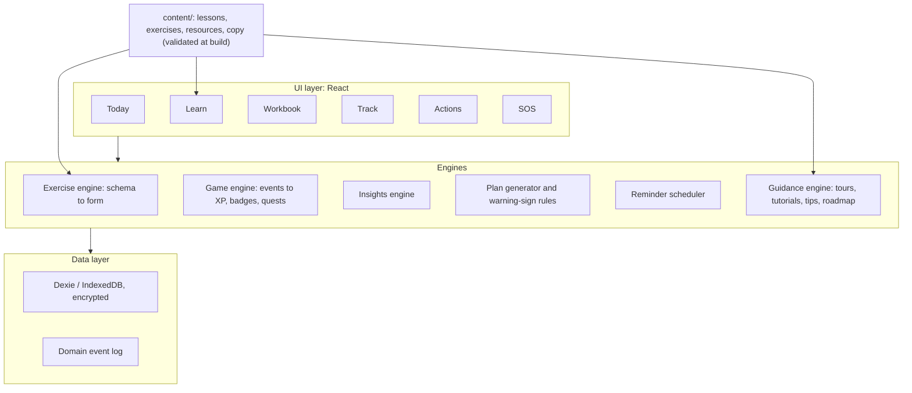

# 1-addic: Product & Execution Plan

> **Status:** Draft v0.4 (v0.2 added the in-app tutorial and Learning Roadmap; v0.3 added the Harbor world as a game-theme option; v0.4 adds the Unity question to D3 with a feasibility spike (§10.1, §10.8), licensing and devices (§9.1), the Evidence & sources screen (§5.12) and the visual-quality budget (§10.8); see [`docs/design/game-concept-review.md`](design/game-concept-review.md)), for review and refinement (by the owner and a Fable review chat) **before any building starts.**
> **Build steps and prompts:** [`docs/BUILD-GUIDE.md`](BUILD-GUIDE.md).
> **Source material:** *The Addiction Recovery Skills Workbook* (Glasner-Edwards; New Harbinger). It is summarized in [`docs/book/`](book/README.md); every exercise is inventoried in [`docs/book/exercises.md`](book/exercises.md).
> **Conventions:** 🟡 **DECISION** = needs an answer in review (all collected in §15). "Ex N.M" = an exercise from the book.

---

## How to review this plan

1. Read **§0 (TL;DR)** and **§3 (the core concept)** first. If those are wrong, the rest is too.
2. Answer the decisions in **§15**. Each one has a recommended default, so "accept the default" is a valid answer.
3. Challenge **§6 (gamification)** and **§8 (safety)** hardest. That's where a recovery app can do real harm.
4. Check scope against **§12 (roadmap)**. The MVP is intentionally small.

Suggested prompt for the Fable chat: *"Review `docs/PLAN.md` for this addiction-recovery app. Stress-test the product concept, the gamification ethics, the safety design and the phasing. For each decision in §15, give a recommendation with reasoning. List what's missing, what's over-scoped, and what you'd cut from the MVP."*

---

## 0. TL;DR

Build a **phone-first, private, offline-capable app** that turns the workbook into four connected layers:

1. **Learn**: a guided Journey of 11 short modules (Start Here, Understand, Brain, 7 Steps, Plan). Every lesson ends with the book's real exercise in **tutorial mode**.
2. **Workbook**: the **living personal artifacts** those exercises produce: Reasons Card, Trigger Profile, Red Flags and Comebacks, Support Network, Activity Library, Warning Signs, and finally **My Recovery Plan**.
3. **Track + Actions**: daily and weekly practice. Quick craving and mood logs, morning and evening check-ins, a day planner, **Battle Plans** for high-risk situations, pleasant activities with self-chosen rewards, and a weekly review.
4. **SOS** (always one tap away): walks the user through a ~15-minute craving, or a hard emotion, or a slip, using *their own* reasons, people and skills. Works offline, no login.

A **gentle game layer ("Two Brains")** rewards *practice and honesty*, never claims of abstinence. It has **no streak resets, no randomized rewards, and no leaderboards**, and it can be switched off.

The app teaches *itself* the way good games and productivity apps do. A short **first-run tour**, a safe **SOS practice drill**, **just-in-time tutorials** as each feature appears, and an **Explorer checklist** introduce features gradually instead of all at once. A personal **Learning Roadmap** shows the whole journey: where you are, what's next, how long it takes, and what each step unlocks (§5.10, §5.11).

**Key recommendations**

| # | Recommendation | Why |
|---|---|---|
| 1 | **Build SOS first**, before lessons | The craving moment is where the app earns its place. It needs to work from day 1. |
| 2 | **One schema-driven exercise engine; content as data** | About 50 exercises reduce to about 15 field types. It keeps scope sane and content editable. |
| 3 | **One unified log model** | Ex 5.4, 6.3, 8.1, 9.1 and 9.2 are the same shape. One quick-log flow beats five forms. |
| 4 | **Gamify practice, not sobriety. Never wipe progress after a slip.** | The book's "spiraling lapse" (Ch 5) is exactly what streak-resets trigger. |
| 5 | **Local-first and private by default.** No account needed. | Highly sensitive data. The threat model includes people at home. |
| 6 | **PWA (React + TypeScript) first; Capacitor native wrapper later** | One codebase. Easy to build and test in Claude Code cloud sessions. App stores later. |
| 7 | **Write original content** based on the evidence-based techniques; reference the book's chapters | The book is copyrighted. Original content lets you ship. See §7. |
| 8 | **Clinical review and safety flows before any public release** | Withdrawal, overdose and suicide risk are real. See §8. |

---

## 1. Vision & goals

**Product statement.** *A pocket recovery coach that teaches the skills from the workbook and then helps you use them in the moments that matter, in your own words.*

### Personas (illustrative)

| Persona | Situation | What they need most |
|---|---|---|
| **Sam**, 2 weeks alcohol-free, Action stage | Evenings alone are the danger zone. Craving 6–8/10 most nights. | SOS, an evening plan, Safety Nets one tap away, a reason to keep logging |
| **Jordan**, daily cannabis for 8 years, Contemplation | Not sure they want to quit. Defensive about lectures. | A non-judgmental motivation module (Ch 3), no pressure, private |
| **Alex**, 7 months off opioids, Maintenance, attends NA | Things are stable; complacency is the risk. | Warning-sign radar, light-touch weekly check-ins, overdose-risk awareness if a slip happens |
| *(secondary)* Therapist or sponsor | Sees the user weekly | A clean export of logs and the plan to discuss in session |

### Goals

- **G1 Teach.** Cover every concept and exercise in the book in bite-size (3–6 min) sessions.
- **G2 Personalize.** Every exercise produces a reusable personal artifact. Nothing is "done once and forgotten."
- **G3 Help in the moment.** Craving and emotion help within **2 taps**, offline.
- **G4 Build the habit.** Daily check-ins and a weekly review ritual (the book asks for weekly look-aheads for at least the first 6 months).
- **G5 Self-knowledge.** Show users patterns from their own data (triggers, times, what helps).
- **G6 Safe & private.** Crisis-ready, medically careful, discreet.

### Non-goals (v1)

Diagnosis or treatment claims. Replacing therapy or groups. A public community feed or social network. Behavioral addictions such as gambling (out of the book's scope). Moderation and harm-reduction *goals* (the book is abstinence-based; *safety* info is still included, §8). A clinician dashboard. User accounts (a purchase plan with device-bound keys is not an account: no email, password or profile; see §9.1).

### What "working" looks like (measured locally or by opt-in only)

- Users complete SOS sessions and report "the urge passed" (self-report).
- Skills get rated as helpful, and the user's go-to list emerges by week 4–6.
- Weekly review is completed ≥3 of 4 weeks in the first 2 months.
- The user finishes the Journey and has a **My Recovery Plan** they actually open.
- Qualitative: people in recovery say it feels respectful, useful and safe.

---

## 2. Design principles

1. **Help in the hard moment first.** SOS is ≤2 taps from anywhere, offline, without login, and readable when your hands are shaking (big targets, few words, voice input).
2. **Learn it → Try it → Use it.** Every concept becomes a tool you use in real life.
3. **Your words, reflected back.** The app's most powerful content is what the *user* wrote: their reasons, their comebacks, their people, surfaced at the right moment.
4. **Practice over perfection.** Reward effort, honesty and skill use, not outcomes the user can't fully control.
5. **A slip is data, not a verdict.** Never shame. Never wipe progress. Always offer a way back (book Ch 5 and 10).
6. **Be smart, not strong.** The app never dares the user to face triggers or "test" willpower (book Ch 4).
7. **Respectful, adult, accurate.** Use Rawson's foreword principles: educate accurately, empower, never preach or condescend, be relatable. Use person-first language.
8. **Private by default, discreet by design.**
9. **Small steps.** One thing per screen. Sessions of 2–5 minutes. Low cognitive load.
10. **Point outward.** The game should push users toward *real-life* rewards (pleasant activities, people, meetings, exercise), not more screen time. In the book's evidence, a wide range of enjoyable activities was the strongest predictor of staying sober.

---

## 3. Core concept: four layers

Your initial vision maps onto the layers like this:

| Your vision | App layer | What it is |
|---|---|---|
| "Learning + workbook tutorial" | **Learn** tab (the Journey) | Lessons, then the exercise in *tutorial mode* (examples, hints, explanations) |
| "Dedicated workbook" | **Workbook** tab | All personal artifacts: browse, edit, see history, re-do, export |
| "Task tracker and actions" | **Track** tab + **Actions** tab | Logs, check-ins and insights · planner, Battle Plans, quests, pleasant activities, rewards, weekly review |
| *(suggested addition)* | **SOS** button (global) + **Today** (home) | In-the-moment help · today's plan and next best step |
| "In-app tutorial" and "roadmap for learning" | **Guided tutorial system** + **Learning Roadmap** (home of the Learn tab) | The app teaches itself step by step (tour, drills, just-in-time tutorials, tips, Explorer checklist) · a personal map and timeline of the whole journey (§5.10, §5.11) |



**Same component, two modes.** Each exercise is one component with two modes. *Tutorial mode* (inside a lesson) adds worked examples, per-field explanations and a "you built X" ending. *Workbook mode* (later edits, daily use) is fast and compact.

---

## 4. Information architecture

**Bottom navigation:** `Today` · `Learn` · `Workbook` · `Track` · `Actions`. A **floating SOS button** sits on every screen. Later it's also available as a home-screen shortcut and widget (Phase 5).

| Area | Screens |
|---|---|
| **Today** | Morning/evening check-in card · today's plan with risky blocks highlighted and their Battle Plans · "Want-to of the day" · continue learning · active quests · Reasons Card peek · counters (opt-in) |
| **Learn** | **My Learning Roadmap** (Map view and Plan view, "this week's focus") → module page (lessons, progress) → lesson player (cards → check → try it → wrap) · glossary |
| **Workbook** | *My Why:* Reasons Card, Decisional Balance, Motivation history · *Know Myself:* Trigger Profile, Red Flags & Comebacks, Thought Journal, Craving and Anger Signatures, Warning Signs · *My People:* Support Network, Scripts · *My Joys:* Activity Library, Should/Want balance, Distraction deck · **My Recovery Plan** |
| **Track** | Quick-log (+): Craving · Feeling · Check-in · Exercise · Mindfulness · Meeting · Slip · Timeline · Insights · Counters |
| **Actions** | Planner (day/week) · Battle Plans · Quests · Pleasant-activity queue and Rewards · Weekly Review · To-dos generated by exercises |
| **SOS** | I'm craving · I'm feeling… · I slipped · I need urgent help |
| **Settings** | App lock · Discreet mode · Terminology · Notifications · Export/Import/Delete · Accessibility · Calm mode (game off) · Resources · **Help & tutorials** (replay any tutorial, "How do I…?", tips on/off, "show all features now") · **About & evidence** (§5.12) · **Your devices and plan** (§9.1, native phase) |

### Wireframe sketches (low-fi, for discussion)

```
┌───────── TODAY ─────────┐   ┌────────── SOS ──────────┐
│ Good evening, Sam       │   │ You opened this. That's │
│ Day 15 · 9 urges surfed │   │ your rational brain at  │
│ ┌─────────────────────┐ │   │ work.                   │
│ │ Evening check-in  ▶ │ │   │                         │
│ └─────────────────────┘ │   │ How strong?  0 ──●── 10 │
│ Tonight                 │   │ 15:00  wave timer       │
│  7:30 Free time  risky  │   │                         │
│   └ Battle plan: call   │   │ [ Ride the wave       ] │
│     Mia, then walk      │   │ [ Remind me why       ] │
│  8:00 Want-to: guitar   │   │ [ Call someone        ] │
│ Continue: Step 3 · L2 ▶ │   │ [ Distract me         ] │
│ Quest: Build Your Crew  │   │ [ Talk back           ] │
│                 [SOS]   │   │ Need urgent help?  →    │
└─────────────────────────┘   └─────────────────────────┘
```

---

## 5. Feature specifications

### 5.1 Onboarding (≤3 min; every step skippable except the safety notice)

1. **Welcome**: what this is (a skills coach based on CBT, motivational interviewing and mindfulness) and what it isn't (not treatment, not a diagnosis). Crisis info is always available.
2. **Privacy promise**: data stays on this device. Set an **app lock** (recommended). Optional **discreet mode** (neutral name, icon and notifications).
3. **Your focus**: substance(s) (multi-select plus free text), terminology preference (*sober / clean / substance-free / in recovery*), optional start date, or "I'm not sure yet" (the contemplation path).
4. **Where you are**: stage of change plus a 0–10 motivation slider (Ex 3.1). This sets the app's tone and recommended path.
5. **Medical safety check** (not a diagnosis): "Do you drink heavily every day, or use benzodiazepines or opioids?" If yes, show a card: *stopping suddenly can be dangerous; talk to a doctor about safe withdrawal*. Link to resources.
6. **Make SOS useful on day 1**: pick 3 quick reasons (chips taken from Ex 3.2 examples, editable), add 1 Safety Net contact (optional), choose region (for crisis lines).
7. **Rhythm**: check-in times, the weekly review day, and a **learning pace** (gentle, steady or focused) that sets up the Learning Roadmap (§5.11).
8. **First-run tour and SOS practice drill** (about 2 minutes, skippable, replayable; §5.10). Then land on **Today** with "Start Here" as the first suggested lesson.

### 5.2 SOS: the most important feature

**"I'm craving"** (book Ch 6 and 7: surf, distract, delay, SOBER; Ch 3 Reasons Card; Ch 4 Safety Nets):



- **"Guide me"** runs a default sequence: SOBER (2 min), then Reasons Card, then one distraction, then re-rate. Over time the order is personalized by what the user rated as helpful.
- **Context prompt:** "Are you somewhere risky right now? Leaving is a valid move." (Ch 6: leave the situation.)
- **Logging is a by-product.** The SOS session *becomes* a craving log entry (Ex 5.4). Trigger, thought and feelings can be added in 1 tap, or later.
- **Design constraints:** works offline; nothing to read longer than 2 lines; one-handed use; dark by default at night; never shows a lesson or an upsell.

**"I'm feeling…"** (Ch 9): angry · sad/down · anxious · lonely · bored · ashamed · other.
- *Anger* → **Give it a beat**: count-to-10 timer, "step away" prompt, breathe, self-talk cards, a ready-made assertive line ("I'm upset; I need time to gather my thoughts").
- *Sad or anxious* → SOBER, reassuring phrases, acceptance phrases, a quick pleasant activity, call someone.
- Always: an optional motivation re-rate and an emotion log entry.

**"I slipped"** → **Lapse Recovery** (Ch 5 spiraling lapse; Ch 10 stopping the slip):
1. **Compassion first.** "A slip isn't a relapse. You opened this. That's your rational brain."
2. **Safety check.** Are you safe right now? If the substance is opioids or another depressant after a break: **lower tolerance means higher overdose risk**; don't use alone; naloxone info; emergency number. Show alcohol and benzodiazepine withdrawal cautions where relevant. *(Copy reviewed by a clinician; see §8.)*
3. **Stop the spiral.** Show the user's own spiral thoughts (Ex 5.2c) next to rebuttals: "I can stop now. This doesn't erase my progress."
4. **Reach out.** One tap to a Safety Net, sponsor or counselor.
5. **Within 24 h:** the **Slip Review** (Ex 10.2), a motivation revisit (Ex 3.2/3.3), and "step up support" actions that feed back into My Recovery Plan.
- **Counters:** *total* sober days and all XP, badges and skill levels stay. The "current run" restarts quietly (and is only shown if the user opted in).

**"I need urgent help":** region-aware crisis lines (for example, 988 in the US), the emergency number, poison control, overdose steps, and an international helpline directory. Shown at the top of SOS at all times and triggered automatically by crisis signals (§8).

### 5.3 Learn: the Journey

About **55–60 lessons** in **11 modules**. Lessons are 3–6 minutes. A suggested pace is about 1 module per week, which matches the book's "practice before moving on."

| # | Module (app name) | Book | Lessons (draft) | Exercises in tutorial mode → artifacts/tools unlocked |
|---|---|---|---|---|
| M0 | **Start Here** | Intro | What this app is · Two brains · How to use the Journey | — → SOS tour, Reasons Card quick-start |
| M1 | **Understand Addiction** | Ch 1 | How use becomes addiction · Signs and symptoms · "Why me?" risk factors · Asking for help | Ex 1.1, 1.2, help-request script, program checklist |
| M2 | **Your Brain Can Heal** | Ch 2 | The dopamine flood · Learned cues · Addicted vs. rational brain · Treatment and medications · The brain heals | Quizzes only → Brain Map intro |
| M3 | **Step 1: Find Your Why** | Ch 3 | Stages of change · Ambivalence is normal · Decisional balance · Four lenses · "+1 point" | Ex 3.1, 3.2, 3.3 → **Reasons Card**, Motivation Meter |
| M4 | **Step 2: Set Yourself Up** | Ch 4 | Clear the space · Seemingly irrelevant decisions *(interactive story)* · Move your body · Safety Nets · Saying it assertively and saying no · Grow your network and groups | Ex 4.1–4.7 → Support Network, Scripts, Exercise plan, quests |
| M5 | **Step 3: Become a Self-Expert** | Ch 5 | The chain · Your triggers · Red flag thoughts · Six thinking traps *(Distortion Sort)* · The spiraling lapse · Your craving signature and self-monitoring | Ex 5.1–5.4 → **Trigger Profile**, **Red Flags**, Craving Signature, craving log |
| M6 | **Step 4: Outsmart the Addicted Brain** | Ch 6 | Put it on trial · Superficial truths · Thinking vs. doing · Surf, distract, delay · Plan your day · Battle Plans | Ex 6.1–6.5 → **Comebacks**, Distraction deck, Planner, **Battle Plans** |
| M7 | **Step 5: Be Present** | Ch 7 | What mindfulness is · Autopilot · Body scan · Everyday mindfulness · Breathing · **SOBER** · Acceptance and self-compassion | Ex 7.1–7.4 → audio practices, SOBER in SOS |
| M8 | **Step 6: Rediscover Joy** | Ch 8 | Rewards and recovery · Track your days · Should dos and want tos · Pleasant (not risky) activities · Obstacles · Pleasure predicting · Reward follow-through | Ex 8.1–8.7 → **Activity Library**, Balance, experiments, Rewards |
| M9 | **Step 7: Handle Hard Feelings** | Ch 9 | Mood and recovery · Mood and anxiety logs · Challenging negative thoughts · Anger: give it a beat · Quick coping and revisiting motivation | Ex 9.1–9.6 → emotion logs, Anger Signature, "I'm feeling…" SOS |
| M10 | **Your Recovery Plan** | Ch 10 | Weekly look-ahead · Warning signs · Stopping a slip · **Build my plan** (graduation) | Ex 10.1–10.3 → **Warning Sign Radar**, **My Recovery Plan**, Weekly Review |

**Lesson anatomy:**
1. **Moment:** a 30-second story beat with an original character.
2. **Concept cards:** 2–5 swipeable cards in plain language, each with an illustration.
3. **Check:** 1–3 quick questions. No fail state; every answer gets an explanation.
4. **Try it:** the exercise in tutorial mode. "Finish later" is allowed.
5. **Wrap:** what you built, where it lives, and one suggested action (which becomes a to-do in Actions).

**Order and unlocking.** The **Learning Roadmap** (§5.11) shows the recommended order and pace (the book says to do Part 2 in order) but **doesn't hard-lock** content, for user autonomy. **SOS and crisis tools are never gated.** Lessons unlock *personalization*, not *access*. Motivation (M3) is revisitable at any time, as the book recommends. Contemplation-stage users get a path that brings M3 forward and softens the tone.

### 5.4 Workbook: living artifacts

| Artifact | Built by | Reused in |
|---|---|---|
| **Reasons Card** (drawbacks of using + benefits of quitting + "my life will be different because…") | Ex 3.2, 3.3 (seeded in onboarding) | SOS first screen, lock-screen wallpaper export, lapse flow, weekly review |
| Decisional Balance (2×2) | Ex 3.2 | Motivation revisits (Ch 9, Ch 10) |
| Motivation history (0–10 time series and "+1" notes) | Ex 3.1, 3.3, 9.6 | Insights, weekly review |
| **Trigger Profile** (internal/external; ✓ experienced, ★ frequent; craving and anger tags) | Ex 5.1, 9.4 | Log chips, Battle Plans, insights, activity risk-check |
| **Red Flags & Comebacks** | Ex 5.2 → 6.1/6.2 | SOS "Talk back", Courtroom |
| Thought Journal (distortion-tagged) | Ex 5.2b, 9.3 | "Put It On Trial", insights |
| Spiral thoughts | Ex 5.2c | Lapse Recovery |
| Craving and Anger Signatures (body map + feelings + thoughts) | Ex 5.3, 9.3b | Log pre-fill, SOBER "Observe" step |
| **Support Network** (Safety Nets, risky people and their strategy, sponsor, therapist) | Ex 4.4, 4.6 | SOS "Call someone", Battle Plans, Recovery Plan |
| Scripts ("I feel… when… I need…", refusals, help requests) | Ex 4.5, refusal skills, 1.x | Role-play, before hard conversations |
| **Activity Library** (should/want, risky-for-me flag) | Ex 8.0, 8.2, 8.3 | Planner, "Want-to of the day", gap filling |
| Distraction deck | Ex 6.3b | SOS "Distract me" |
| **Warning Signs** (top 3 with plans) | Ex 10.1 | Warning Sign Radar |
| **My Recovery Plan** | Ex 10.3 (auto-pre-filled) | SOS, export, monthly review |

Every artifact supports: **view · edit · version history** (each save is a snapshot) · **"practice with this"** · **export/print**. Sensitive ones (risk factors) can be hidden behind an extra lock.

### 5.5 Track: logs, check-ins, insights

**One `LogEntry` model** with typed sections (see §10.4). Quick-log targets **≤20 seconds**:

- **Craving** (Ex 5.4 + optional 6.3): time (auto) · situation and trigger chips · thought (text and red-flag chips) · feelings chips · intensity 0–10 · what I did (skill chips) · helped? (1–5) · used? (Y/N) · optional "Put it on trial."
- **Feeling** (Ex 9.1/9.2): emotion · intensity 0–10 · situation · thought · same-day craving 0–10.
- **Morning check-in** (1 min): today's plan glance · risky blocks → Battle Plan · one want-to · intention.
- **Evening check-in** (1–2 min; Ex 8.1 daily totals + Ch 10 warning-sign inputs): mood 0–10 · anxiety 0–10 (optional) · peak craving 0–10 · pleasant activities (auto-counted, editable) · used today? · sleep quality · meeting or therapy attended?
- **Activity logs:** exercise (Ex 4.3), mindfulness minutes (Ch 7), meetings (Ch 4), pleasant activity done (Ch 8).
- **"7-Day Activity Experiment"** (Ex 8.1, hourly tracking): a time-boxed quest, not a forever chore.
- **Voice input** on every text field where the platform supports it.

**Insights** (computed on-device; written as gentle observations with small-sample caveats):
- Craving intensity over time; **top triggers**; **time-of-day/day-of-week heat map** (this feeds "risky times" suggestions)
- Mood vs. pleasant-activity count vs. craving (Ch 8's core claim, shown on *their* data)
- **Skill helpfulness ranking** (this feeds the Recovery Plan)
- Pleasure **predicted vs. actual** (Ch 8)
- Motivation history

**Counters** (never reset): total sober days · urges surfed · plans followed · pleasant activities done · mindful minutes · optional **money and time reclaimed** (the user enters typical spend; the book lists "saving money" as a benefit).

### 5.6 Actions: planning, quests, rewards

- **Planner** (Ex 6.4): day and week views. Blocks are typed *should / want / recovery* (meeting, therapy, exercise) *or risky*. **Gap detection** flags unstructured time (a Ch 10 warning sign) and suggests want-tos at the user's risky times (Ch 8 principle 4).
- **Battle Plans** (Ex 6.5): attached to risky blocks or events: situation · plan · backup 1 · backup 2 · buddy · exit plan. A reminder fires beforehand. A **debrief** follows ("Did you use your plan? How did it go?"). Export to the phone calendar (.ics).
- **Weekly Review** (Ch 10, strongly suggested for the first 6 months; about 5 min): last week's highlights → motivation re-rate and "+1" → upcoming high-risk situations become Battle Plans → schedule 3 want-tos with rewards (Ex 8.7) → exercise target (Ex 4.2) → pick a focus skill.
- **Quests** (one-off and short series, from the exercises): Clear the Space · Build Your Crew · Try an Exercise · 7-Day Activity Experiment · SOBER Training (4 stages) · Everyday Mindfulness (3) · Prediction Lab (5) · Script Rehearsal.
- **Pleasant activities and rewards:** library → risk check ("Could this trigger me?" from Daniel's lesson) → schedule → do → **self-chosen real-world reward** (Ex 4.3, 8.7).
- **To-dos** generated by exercises (for example, "Delete dealer numbers," "Text Mia about coffee").

### 5.7 My Recovery Plan (the capstone)

- **Auto-pre-filled from real data:** skills ranked by helpfulness × use, Safety Nets, top triggers, warning signs and their plans, Reasons Card, standard Battle Plans, mood and anger tools. The user edits and confirms each section (the Ex 10.3 structure).
- **Graduation** at the end of M10: a celebration plus a printable or PDF plan to share with a therapist or sponsor.
- **Pinned in SOS.** A monthly "still true?" review. After 6 months, the app suggests **Maintenance mode**: a lighter Today screen, a weekly cadence, and the radar staying on.

### 5.8 Resources

Crisis lines · finding treatment (the Ch 1 "questions to ask" checklist) · medications (educational, dated, linked to authoritative sources) · mutual-help groups (AA, NA, SMART Recovery and others) and meeting finders · therapist finders · mindfulness audio. Kept in a **content file** so links can be updated without code changes. Region-aware.

### 5.9 Settings & privacy controls

App lock (PIN, biometric later) · discreet mode · terminology · notifications (with quiet hours and a daily cap) · export (full JSON and PDF) · import · **delete everything** · backup reminder · accessibility (text size, dyslexia-friendly font, reduced motion, high contrast) · **Calm mode** (game layer off) · **Help & tutorials** · **About & evidence** (§5.12) · **Your devices and plan** (§9.1, native phase).

### 5.10 In-app tutorial: the app teaches itself

The app has many features. Showing them all on day 1 would overwhelm anyone, and someone in early recovery has less attention to spare. So the app teaches itself **gradually, by doing**, the way good games and productivity apps do. There are no long slideshows.

**Principles**
- **Just in time.** Teach a feature when it first becomes useful, not before.
- **Learn by doing.** Every tutorial step is a real tap on the real screen, using the user's own data. Practice drills use clearly marked sample data.
- **Short.** One sentence per step, three to five steps per tutorial, under 60 seconds.
- **Skippable and replayable.** Every tutorial can be skipped and replayed from **Help & tutorials**. Nothing important is ever locked behind one.
- **Never in a real crisis.** No tips, tours or popups inside a live SOS session or the crisis screen.
- **Guided by the companion.** The Rational Brain companion (§6.2) speaks the tutorial lines, so the tutorial feels like part of the story. In Calm mode the same steps appear without game styling.

**The six parts**

| Part | What it is | When it appears |
|---|---|---|
| **1. First-run tour** (~2 min) | Spotlights on the five tabs and the SOS button: "This is Today, your plan for the day," and so on. Ends at the SOS drill. | Right after onboarding. Skippable. |
| **2. SOS practice drill** | A calm, 1-minute run through the craving flow with sample content: rate, pick a tool, see your Reasons Card, finish. Like a fire drill, so the first real use isn't the first time. Saved as practice, never as a real log. | End of the first-run tour, then offered again once a week for the first month and after building new SOS content (Reasons Card, Comebacks) |
| **3. Just-in-time tutorials** | A 3–5 step interactive walkthrough the first time each feature appears: Planner, Battle Plans, Workbook artifacts, Insights, Weekly Review, Recovery Plan, and others. Each ends by *doing the thing once* ("Now add tonight's free time to the plan"). | First visit to a feature, or when a lesson unlocks it. A "Show me / Later" choice every time. |
| **4. Practice drills ("Training")** | Short practice versions of key skills with sample data: SOBER drill, quick-log drill, Battle Plan drill, Put It On Trial drill, refusal drill. They build confidence before the real moment. | Offered at the end of the lesson that teaches the skill. Always available under Help & tutorials → Training. |
| **5. Contextual tips** ("Did you know?") | One small tip based on what the user actually does. For example: after a craving log with a red-flag thought, "You can talk back to that thought. Try Put It On Trial." | At most one a day, never during SOS, and switchable off. |
| **6. Explorer checklist** | A "Get to know your app" list of about 12 first actions (see below) with a progress ring. Finishing it earns the *Explorer* rank. | On Today until finished or dismissed, then under Help & tutorials |

**Explorer checklist (draft):** take the tour · do the SOS drill · build your Reasons Card · add a Safety Net · log a craving or feeling · do an evening check-in · finish your first lesson · open your Workbook · plan tonight's free time · try one breathing practice · schedule one want-to · set up your Learning Roadmap pace.

**Progressive feature reveal.** New features appear as the Journey reaches them, each with a small "New" dot and its just-in-time tutorial. SOS, crisis help, quick-log and check-ins are there from day 1. **Nothing is truly locked.** "Show all features now" in Settings reveals everything at once for people who prefer that (🟡 D17).

| When | What appears (with its tutorial) |
|---|---|
| Day 1 | Today, SOS (+ drill), quick-log, evening check-in, Reasons Card (quick), Learn: Start Here |
| After M0–M2 | Workbook tab, Learning Roadmap Plan view, glossary |
| After M3 | Motivation Meter, Decisional Balance, full Reasons Card, lite Weekly Review |
| After M4 | Support Network, Scripts, quests, exercise plan |
| After M5 | Trigger Profile chips in logs, Red Flags, Insights (once there are 7 or more logs) |
| After M6 | Planner, Battle Plans, Comebacks in SOS "Talk back," Training drills |
| After M7 | Audio practices, SOBER Training quest |
| After M8 | Activity Library, Rewards, Prediction Lab |
| After M9 | Personalized "I'm feeling…" tools, emotion insights |
| After M10 | Recovery Plan, Warning Sign Radar, full Weekly Review, Maintenance mode later |

**Help & tutorials** (in Settings and the "?" on every screen): replay any tutorial, a searchable "How do I…?" list (each answer is a few lines and a "Show me" button that runs the tutorial), Training drills, tips on/off, and a link to the glossary.

### 5.11 Learning Roadmap: see the whole journey

The Learning Roadmap is the **home screen of the Learn tab**. It answers four questions at a glance: *Where am I? What's next? How long will this take? What do I get at each step?*

**Two views**
- **Map view:** the 11 modules (§5.3) as a path with milestones. Each stop shows its lessons (done and to do), the skills it teaches, and what it **unlocks** (tools, Workbook artifacts, features from §5.10). Finished stops light up the matching region of the progress map (§6.2: Brain Map or Harbor).
- **Plan view:** the same journey as a calendar. Each week shows a target module, its practice goals ("Try SOBER 3 times this week"), and the next milestone date.

**Three tracks on one roadmap**
1. **Learn:** modules and lessons.
2. **Practice:** skill mastery levels (§6.4). A module is truly "done" when you've *used* its key skill a few times, not just read about it. That matches the book's advice to practice before moving on.
3. **Use:** app features introduced so far, and the Explorer checklist.

**Personalized from onboarding**
- **Pace:** *Gentle* (one module every 2 weeks), *Steady* (one a week, recommended) or *Focused* (two a week). Changeable any time.
- **Starting path:** follows the stage of change. Contemplation-stage users get M0 → M1 → M3 (motivation) first, with a softer tone. Action-stage users get the standard order.
- **Weekly focus card:** "This week: Step 3, Become a Self-Expert. 4 lessons, about 20 minutes, plus logging 3 cravings." Shown on Today and in the Weekly Review.

**Checkpoints and milestones**
- At the end of each module, a 1-minute **checkpoint reflection** ("What helped most? What will you keep doing?"). Answers feed My Recovery Plan.
- Milestones: *Self-Expert* (after M5), *Strategist* (M6), *Graduation*: My Recovery Plan (M10), then **Maintenance mode** at 6 months.

**No guilt.** Missed weeks never turn red or show "overdue." The roadmap simply moves forward: "Welcome back. Pick up where you left off?" with an option to re-plan. **Optional review mode** after graduation: a spaced "refresher" stop every month that revisits one module's key skill.

### 5.12 Evidence & sources ("Why this works")

People in recovery are told a lot of things. The app shows where every technique comes from, so it is plain that the content is derived from real research and not made up. That builds trust, and it motivates: "you just used a skill with decades of evidence behind it" is a better reward than a badge.

- **Where:** Settings → **About & evidence**; a small **"Why this works"** link on Today (under the weekly focus card), in every lesson wrap and at the end of every Training drill, opening the matching card.
- **What a card shows:** the technique · the claim in one or two plain sentences · the primary sources (author, year, journal, DOI or URL link) · an evidence-strength label (meta-analysis · randomized trial · review · guideline · theory · book) · the date last reviewed · which app features use it.
- **Rules:** primary sources or major guidelines only; state the claim no more strongly than the source does; the source workbook is credited as the inspiration (title, author, publisher) and never quoted; no overclaiming: the app itself is not clinically tested and the screen says so; every lesson cites at least one reference (validated in CI, §10.6); the clinical advisor checks the list before release (Step 6.1); the text works offline, the links need internet.
- **Seed list:** [`docs/evidence-references.md`](evidence-references.md), about 30 verified references, turned into `content/references/` in Step 2.11.

---

## 6. Gamification design

### 6.1 Why, and the guardrails

The book itself argues for rewards. Ch 4 and Ch 8 say to *reward yourself for following through*, and behavioral economics says *alternative rewards predict sobriety*. The foreword cites contingency management. Self-Determination Theory adds that motivation lasts when people feel **autonomy, competence and relatedness**. But this audience is uniquely vulnerable to compulsive loops and to shame. So:

| ✅ Do | ❌ Don't |
|---|---|
| Reward **practice, honesty, planning, reflection** | Give points for *claiming* sober days (this incentivizes misreporting and punishes honesty) |
| **Cumulative** progress that never disappears | Streaks that reset to zero on a slip, or "you'll lose your streak!" nudges |
| **Mastery**: skills level up with use, as the book says to practice repeatedly | **Random or variable rewards**: loot boxes, spins, mystery chests. These are gambling-like and carry cross-addiction risk. |
| Meaning and narrative (the Two Brains story) | Leaderboards or social comparison of sobriety |
| Point to **real-world rewards the user chooses** | Engagement or time-in-app goals, infinite feeds |
| Celebrate milestones with words, not loot | Challenges involving exposure to triggers ("can you resist…?") |
| Adult, calm aesthetic; **Calm mode** to turn it off | Childish tone, guilt-trip mascots |

**Contingency-management note.** CM works because abstinence is *verified* (for example, by urine tests). An app can't verify it, so XP attaches only to behaviors the user controls and can report without incentive to lie. Sober-day milestones get *celebrations*, not points.

### 6.2 Theme (🟡 DECISION D6)

| Option | Concept | Pros | Cons |
|---|---|---|---|
| **A. Two Brains** *(recommended)* | You train your **Rational Brain** (a companion the user can name) against the **Addicted Brain** (an antagonist voice that literally speaks the user's own red-flag thoughts in the Courtroom and the Distortion Sort). Meta-progress is a stylized **Brain Map** whose regions light up as related skills level up. | Native to the book (Ch 2 onward). Reinforces the science. Adult. Turns "noticing thoughts" into a game. | Brain imagery can feel clinical, so it needs warm illustration. Must avoid implying medical healing claims. |
| B. The Road | The book's brakes/"go mode" metaphor as a road trip. Skills are car upgrades; high-risk situations are tricky intersections. | Intuitive "journey" framing | **Driving can be a trigger or trauma topic** (DUIs are mentioned in the book's intro). Weaker link to the content. |
| C. Garden | A garden that grows with practice and never dies. A slip is a passing storm. | Very gentle and calming | Generic, weaker link to the book's ideas |
| **D. The Harbor** *(world only; from the owner's concept note, Oct 2026)* | A small harbor seen from above instead of a brain map, with A's mechanics underneath. The six skill regions become places: the Lighthouse (thinking clearly), the Cove (calm), the Garden (joy), the Pier (people), the Compass Rose (motivation) and the Weather Station (self-awareness). Cravings are weather that passes; skills are anchors; SOS is safe harbor; a slip is a rough passage that leaves the harbor untouched. Reviewed in [`docs/design/game-concept-review.md`](design/game-concept-review.md). | Calm, adult, non-clinical; no healing claim. Fits the book's wave image and the plan's Compass, Radar, "Build Your Crew" quest and SOS. A discreet-name candidate (D13). | The harbor must never start neglected or decay. No storm visuals during SOS. Water or sailing can be a hard topic for some people; test it. Needs illustration, like A. |

Recommendation: **A's structure in D's world, with C's gentleness**: keep the companion, the Courtroom and the Distortion Sort; draw progress as a harbor that only ever gains light and life (nothing dies or decays). The Brain Map stays the fallback if the harbor tests badly with people in recovery.

**Progress-map regions (Theme A: Brain Map region · Theme D: Harbor place):**

| Region | Harbor place (D) | Skills that grow it | Book |
|---|---|---|---|
| **Command Center** (frontal lobe) | The Lighthouse (its beam cuts through fog and sweeps ahead) | Put It On Trial, spotting distortions, Battle Plans, scheduling | Ch 5, 6 |
| **Calm Core** (stress system) | The Cove (still water inside the breakwater) | SOBER, breathing, body scan, acceptance, give it a beat | Ch 7, 9 |
| **Joy Circuit** (reward system) | The Garden on the hill (grows only from real-world activity) | Pleasant activities, exercise, pleasure predicting, rewards | Ch 4, 8 |
| **Connection Hub** | The Pier (a lantern per person in the crew) | Safety Nets, assertive scripts, refusals, meetings | Ch 4 |
| **Compass** (motivation) | The Compass Rose (the reasons are the heading) | Reasons Card, motivation check-ins, "+1" | Ch 3 |
| **Radar** (self-awareness) | The Weather Station (logbook and forecast; the Warning Sign Radar is its radar) | Trigger logging, craving and mood logs, warning signs | Ch 5, 9, 10 |

### 6.3 Core loops

| Loop | Cadence | Flow | Payoff |
|---|---|---|---|
| **Moment** | ~15 min | Craving or feeling → SOS tool → re-rate → "what helped?" | "Wave surfed," XP to that skill, the Rational Brain reflects the user's own words back |
| **Daily** | 2× per day | Morning check-in → plan, risky blocks, one want-to → do a lesson *or* a practice → evening check-in | Daily wins summary, Momentum ring |
| **Weekly** | 1× per week | Weekly Review → Battle Plans for the week → want-tos with rewards → recap | Weekly recap card, Battle Plan debriefs |
| **Journey** | Weeks | Modules → artifacts → progress-map regions → **Recovery Plan graduation** → Maintenance | Chapter completions, graduation |

### 6.4 Progression systems

- **XP** (illustrative values, to be tuned; diminishing returns on repeated identical logs to prevent grinding):

  | Action | XP |
  |---|---|
  | Log a craving or feeling | 5 |
  | Morning or evening check-in | 5 |
  | Use and rate a skill | 5 |
  | Finish an SOS session (any outcome) | 15 |
  | Complete a lesson | 10 |
  | Build or update an artifact | 20 |
  | Make a Battle Plan / debrief it | 10 / 15 |
  | Do a pleasant activity / exercise session | 10 |
  | Mindfulness | 1 per minute (cap 20/day) |
  | Weekly Review | 25 |
  | **Slip Review** (honesty and learning) | 25 |
  | Finish a feature tutorial or Training drill (first time only) | 5 |
  | Finish the Explorer checklist / a roadmap checkpoint | 25 / 10 |

- **Skill mastery:** about 30 skills from the Ch 10 checklist. **Levels 1–5 at 1, 3, 7, 15 and 30 uses.** Mastered and helpful skills flow into the Recovery Plan.
- **Momentum** instead of streaks: "practiced on X of the last 14 days." A rolling window that **never drops to zero because of one bad day**.
- **Ranks** tied to the book's language: *Explorer → Self-Expert → Strategist → Mindful Navigator → Builder → Guide* (roughly aligned with the modules).
- **Sober-day milestones** (1, 3, 7, 14, 30, 60, 90, 180, 365): celebration messages, no XP. The **total** count never resets. The current run is opt-in display.
- **Cosmetic unlocks** (themes, companion looks) earned **deterministically** from practice milestones. Nothing random, nothing purchasable.

### 6.5 Quests & mini-games

| Name | Type | Book | Mechanic |
|---|---|---|---|
| Clear the Space | Setup quest | Ex 4.1 | Checklist of things to remove → "Be Smart, Not Strong" badge |
| Build Your Crew | Quest line | Ex 4.4, 4.6, 4.7 | Add Safety Nets, reach out twice, try a meeting |
| The Big Game | Interactive story | Ch 4 (SIDs) | A branching story with an original character. Each "harmless" choice shows the chain toward relapse. Replayable. |
| Distortion Sort | Mini-game | Ex 5.2b | Swipe thoughts into the 6 thinking traps, with explanations. Then write your own. |
| Spot the Red Flag | Quiz | Ex 5.2 | Find the relapse-justifying lines in a dialogue |
| **Put It On Trial** | Courtroom tool | Ex 6.1–6.3, 9.3 | Prosecution (the evidence for) vs. defense (the facts) → verdict → closing statement saved as a **Comeback** card |
| Ride the Wave | Calm timer | Ch 6 | 15-min wave animation. No score, ever. |
| **Battle Plans** ("bosses") | Planning | Ex 6.5 | A high-risk event is the boss. Plan + 2 backups. *Victory = you planned and debriefed*, not a judgment on the outcome. |
| SOBER Training | Practice quest | Ex 7.4 | 4 stages: imagined → stress → emotion → real craving |
| Everyday Mindfulness | Practice quest | Ex 7.2 | Shower · fruit · walk |
| 7-Day Activity Experiment | Tracking quest | Ex 8.1 | Hourly logs for 7 days → insight reveal |
| Prediction Lab | Experiments | Ex 8.5/8.6 | 5 predicted-vs-actual experiments → "Mood Lies" badge |
| Refusal Rehearsal | Dialogue game | Ch 4 | Choose-your-response scenes with feedback based on the book's refusal checklist |
| Rewrite the Scene | Reflection | Ex 9.5 | Replay an anger moment and script better responses |
| Explorer checklist | Onboarding quest | — (§5.10) | About 12 first actions with a progress ring → *Explorer* rank |
| Training drills | Practice | Ch 5–7 | SOS, SOBER, quick-log, Battle Plan, trial and refusal drills with sample data |

### 6.6 Badge examples

*Be Smart, Not Strong* (cleared the space) · *First Wave* / *Wave Rider ×10 / ×50* (urges surfed) · *Self-Expert* (Trigger Profile + Red Flags built) · *Objection!* (10 trials) · *Safety Net Weaver* (3 Safety Nets) · *Said It* (an assertive script used in real life) · *Mood Lies* (actual enjoyment > predicted) · *Calm Core* (SOBER in all 4 contexts) · *Planner* (4 weekly reviews) · *Comeback* (completed a Slip Review; framed as courage, shown once and not farmable) · *Graduate* (Recovery Plan built).

### 6.7 Slips inside the game

Nothing is taken away. The companion's message is "This is data. Let's learn from it." The Slip Review earns XP (honesty is a skill). The Brain Map doesn't "un-heal" and the Harbor never decays. (We also avoid medical claims either way.) Total sober days are preserved. The current run restarts quietly.

---

## 7. Content strategy & licensing (🟡 DECISIONS D1, D2)

The book is © New Harbinger and the author. **This isn't legal advice. Consult an IP lawyer before any public release.**

| Option | What it means | Pros | Cons |
|---|---|---|---|
| 1. Private companion | For personal use only. The app references the book's chapters; the owner keeps their own copy. | Fastest, most faithful | Can't be distributed or published. Verbatim text still stays out of the repo. |
| **2. Original content** *(recommended)* | Fresh lessons and exercises built on the **evidence-based techniques** (CBT relapse prevention, MI and stages of change, mindfulness-based relapse prevention, behavioral activation), which no one owns. Cite research. Attribute named techniques (for example, SOBER from Bowen, Chawla & Marlatt). **Original characters and stories.** Optional "book companion" references ("see Ch 5"). | Shippable. Ours to evolve. | Writing effort. Needs clinical review. |
| 3. License from the publisher | Contact New Harbinger permissions to use the text and exercises, possibly as an "official companion" | Faithful, brandable | Cost, time, uncertainty |

**Recommendation:** write Option 2 content from the start, so nothing needs rewriting if the app goes public, and keep the book references in content metadata. Don't use the book's title or trademarks as the app name.

**Content pipeline:**
`docs/book/` notes (structure) → lesson outlines → drafted lessons in `content/` (Markdown + YAML) → **plain-language check** (target reading level US grade 6–8) → **clinical review** → user testing → publish.

**Tone guide (summary):**
- Respectful, curious, hopeful, adult-to-adult.
- **Person-first language** ("person in recovery," never "addict" in the app's voice). Avoid "clean/dirty" except where the user chose "clean" as their term.
- Never moralize.
- Copy the book's best phrases *in spirit* (urges are normal, a slip is a learning opportunity, be smart not strong), in our own words.

**Original cast:** 4–6 composite characters across substances, ages and backgrounds. Their stories thread through the modules and provide the tutorial-mode examples.

**Audio:** original guided scripts (body scan, breathing, SOBER, urge surfing, mindful walking). v1 uses device text-to-speech; recorded voice comes later. All offline.

---

## 8. Safety, clinical & ethics

| Area | Plan |
|---|---|
| **Positioning** | A self-help skills app, not a medical device. No diagnosis (Ex 1.1 explicitly isn't one). A visible "not a substitute for treatment" note. |
| **Crisis** | "Need urgent help" is always in SOS. Crisis screen triggers: the user selects thoughts of death or suicide in mood content (the Ch 9 symptom list includes them); extreme hopelessness ratings; optional on-device keyword check on free text (imperfect, privacy-preserving). Shows region lines (for example, 988 in the US), the emergency number, and an international directory. |
| **Withdrawal** | Alcohol and benzodiazepine withdrawal can be life-threatening. Covered in onboarding, M2, and Resources, with "talk to a doctor" before stopping heavy daily use. |
| **Overdose after abstinence** | Tolerance drops; this is the highest-risk moment for opioid users. Covered in the lapse flow and Resources: don't use alone, naloxone, call emergency services. *This goes beyond the abstinence-only book, but it's life-safety.* |
| **Medications** | Educational, dated, sourced (the book's table is a starting point). Always "talk to your prescriber." |
| **Co-occurring conditions** | If mood logs show persistent low mood for more than 1 month into sobriety (the book's rule of thumb), show a gentle, dismissible nudge to see a professional. |
| **Sensitive content** | Risk-factor items (abuse, trauma) get a content note and can be skipped or hidden. |
| **Age** | 18+ (🟡 D9). Minors need a different design and legal basis. |
| **Clinical advisor** | A licensed addiction professional reviews all lessons, crisis and lapse copy, and medical-safety screens before any public release. |
| **User research** | Paid, consented usability sessions with people in recovery, focused on tone, the SOS flow, and gamification reactions. |
| **Ethical engagement** | No dark patterns. Notification cap. Easy pause. No ads. No selling data. |
| **Regulatory** (to confirm with counsel) | US: FDA general-wellness positioning; FTC Health Breach Notification Rule; state consumer-health-privacy laws. EU/UK: GDPR special-category data. HIPAA / 42 CFR Part 2 only matter if partnering with covered entities or treatment programs. |

---

## 9. Privacy & security

- **Local-first.** All data lives on the device (IndexedDB). No account. No server needed for core features.
- **Encryption at rest.** The database payload is encrypted with a key derived from the app-lock PIN (WebCrypto AES-GCM, with a strong KDF). In the native phase, the key moves to the iOS Keychain / Android Keystore.
- **App lock:** PIN first, then biometric in the native phase. Auto-lock timeout.
- **Discreet mode:** neutral app name and icon (native phase), neutral notification text ("Time for your check-in"), no lock-screen previews.
- **Threat model:**
  - Someone at home looks at the phone (the book's Charlie hid use from his parents).
  - A lost or shared device.
  - Notification previews.
  - Cloud backups.
  - A future AI feature sending text off-device.
- **No third-party trackers, ads or analytics SDKs.** Any future metrics are opt-in, aggregate and anonymous.
- **Contacts** are only what the user types in. They are never uploaded. Calls and texts happen through `tel:` / `sms:` links.
- **User control:** full export (JSON) and human-readable export (PDF). Import/restore. One-tap delete-all. Periodic "back up your data" reminders, since browsers can evict storage, especially on iOS.
- **Later sync** (optional): end-to-end encrypted; the server can't read it.

### 9.1 Licensing, devices and sync (owner direction, Oct 2026; 🟡 DECISIONS D4, D15, D19)

The owner wants a **paid app** (one-time fee or subscription) that opens only on a **registered device**, with sync to **up to two more devices on the same plan**.

- **How "the physical id" works honestly.** Phones do not expose a serial number to apps, and browsers expose nothing at all. The reliable equivalent is a **device-bound key pair** created on first run inside the phone's secure hardware (iOS Secure Enclave, Android Keystore). The public key is the device's identity; the private key cannot be copied off the phone, so neither can the identity. Because a web browser cannot do this reliably (keys can be evicted with storage), **licensing starts with the native builds** (Phase 5). The web build stays the free preview and testing channel until then.
- **Purchase and licence.** The purchase goes through the app stores' in-app purchase (required by Apple for digital goods; it handles tax, refunds and family rules; Unity IAP or a Capacitor plugin, depending on D3). A tiny **licence server** receives the store receipt and the device public key and returns a **signed licence token** naming the plan and its devices (maximum 3). The token is cached on the device, checked offline, and renewed when online, with a grace period so a bad connection never locks anyone out. Settings → **Your devices and plan** lists the devices and removes a lost one.
- **Sync** (D4): end-to-end encrypted, as already planned. A pairing flow (QR code or short code) moves the sync key from one device to another; the server stores only ciphertext, device public keys and plan ids. Up to 3 devices per plan.
- **The safety floor** (D19): house rule 2 wins over licensing. **Urgent help, SOS, the person's own artifacts and logs, export and delete work with no licence, offline, after a lapse, or on a removed device.** Licensing gates *new lesson content and sync*, never crisis tools or the person's own data.
- **What the server knows:** plan id, store receipt, device public keys, timestamps. Never health data, names, contacts or analytics. The discreet name matters more now, because store receipts show the app's name (D13).
- **Pricing** (D15): recommended default is a **one-time purchase that includes 3-device sync** (the data is tiny, so sync is cheap to run). A subscription only if ongoing costs (clinical updates, resource verification, support) require it, and then with the safety floor and easy cancellation. Store fees (15–30%), consumer-subscription law and tax go on the counsel checklist (§8).
- **Threat model additions.** The app-lock PIN remains the privacy protection; device binding is licensing, not security. Someone with access to the person's store account could install the app on another phone, but could not open it without the PIN.
- **Where it lands:** purchases and the licence in Phase 5 (Step 5.4, ~1 wk); the sync service in Phase 6 (Step 6.5, ~2–3 wks).

---

## 10. Technical plan

### 10.1 Stack (🟡 DECISION D3)

| Option | Pros | Cons |
|---|---|---|
| **PWA: React + TypeScript + Vite** *(the plan's default; D3 is open, see below)* | One codebase. Runs on any phone or desktop. Instant preview and **Playwright testing in cloud sessions** (Chromium is preinstalled). Offline via service worker. Installable. | Weaker notifications/background (see 10.5). No widgets. iOS storage eviction risk. |
| **+ Capacitor wrapper** *(Phase 5)* | Same code ships to the App Store and Play Store. Native local notifications, biometrics, secure storage, shortcuts and widgets via plugins. | Native build tooling needed (Xcode for iOS) outside the cloud container |
| React Native / Expo | More native feel | Harder to build and test in a cloud container (no simulators). Two UI paradigms if a web version is also wanted. |
| Flutter | Polished UI | New language (Dart). Same simulator problem. |
| **Unity 2D (URP) native app** *(owner's preference, Oct 2026; decided by the Step 0.6 spike)* | The richest tooling for a living, animated progress map (2D animation, particles, lighting, Timeline). Native builds for both stores from one project. Local notifications, in-app purchases, secure storage and biometrics via Unity packages and plugins. An official Unity MCP server (open beta, Unity 6+) lets Claude Code work inside the Editor. Screen readers supported by the Accessibility module (VoiceOver, TalkBack). Unity Personal is free under ~$200k revenue; the splash screen is optional in Unity 6. | A larger app (tens of MB) and a slower cold start than a web app, so the 1-second SOS budget becomes ~2 s unless the spike proves better. Every screen's accessibility hierarchy is built by hand. Text-heavy forms, dictation and voice input need native plugins. No cloud-session preview or browser tests: builds, device tests and MCP run on your own computer. Unity services must be absent, not just off. |
| Hybrid: Unity shell + native WebView for text-heavy screens | Unity for the harbor, SOS animations and the game; lessons, exercises and logs as web pages inside the app, which keeps forms, text, dictation and accessibility easy | Two codebases and skills; WebView quirks; still a Unity-sized app. Only if the spike fails on text input or accessibility but passes on the rest. |

**How D3 gets decided:** a one-week feasibility spike (Step 0.6) builds a throwaway Unity app and measures it against the pass marks in §10.8. Unity if it passes (the owner's preference), otherwise the PWA path. If Unity wins, Step 0.7 rewrites the guide's steps for Unity while keeping every goal, order, "done when" and every safety, privacy, tutorial and accessibility rule.

**Proposed libraries** (pin exact versions at scaffold time):
- React + TypeScript (strict) + Vite
- `vite-plugin-pwa` (Workbox) for offline
- React Router
- Tailwind CSS + accessible headless primitives (Radix-style)
- **Dexie** (IndexedDB) + live queries
- **Zod** for every schema (content and data)
- A small state store (Zustand) for UI state
- Recharts (or visx) for insights
- Framer Motion (respecting reduced motion)
- Web Speech API for TTS and voice input where available
- A print stylesheet or `@react-pdf/renderer` for PDF export

**Quality tooling:**
- Vitest + Testing Library
- **Playwright** end-to-end
- **axe-core** accessibility checks
- ESLint + Prettier
- GitHub Actions CI
- npm (already handled by `.claude/hooks/session-start.sh`)

### 10.2 Architecture



- **Guidance engine.** Decides which tour, tutorial, tip or roadmap nudge to show, from rules over the event log ("first visit to Planner," "M6 finished," "3 craving logs with a red-flag thought and no trial yet"). It enforces the §5.10 limits: never during SOS, at most one tip a day, everything skippable and replayable. Tutorials are **content, not code**: `content/tutorials/*.yaml` lists the steps, each with a target element, one line of copy and the action that completes it.
- **Event-sourced game state.** Domain events (`LessonCompleted`, `LogCreated`, `SkillUsed`, `PlanDebriefed`, `SlipReviewed`…) are appended to a log. XP, badges, quests and mastery are *derived* from it. Rebalancing the XP table later just recomputes. Nothing is ever "lost." It's also easy to test.
- **Warning-sign rules** (Ex 10.1 → detectors). Examples: no meeting logged in 14 days for a user who usually goes weekly · fewer than 2 pleasant activities in 7 days · poor sleep on 3 of the last 5 check-ins · no Safety Net contact in 14 days · large unplanned gaps on weekends · rising negative-emotion intensity. Each detector maps to the user's own plan for that sign.

### 10.3 Content-as-data & the exercise engine

All lessons, exercises, resources and UI copy live in `content/` as Markdown + YAML. They're **validated by Zod in CI** (a broken exercise can't ship). The engine renders field types: `check`, `check★`, `single`, `slider`, `text`, `list[n]`, `matrix2x2`, `pair`, `rows`, `hourgrid`, `plan+backups`, `template`, `bodymap`, `timer`, `audio`, `date`.

Example (illustrative):

```yaml
# content/exercises/urge-planner.yaml
id: urge-planner
version: 1
bookRef: { chapter: 6, exercise: "6.5" }
kind: plan
title: "Battle Plan"
artifact: battlePlans          # where responses are stored
repeat: weekly
fields:
  - id: situation
    type: text
    label: "What's coming up? (day, time, situation)"
    suggestFrom: triggerProfile
  - id: plan
    type: text
    label: "My plan"
  - id: backups
    type: list
    max: 2
    label: "Backup plans"
  - id: buddy
    type: contactPicker
    filter: safetyNet
    optional: true
tutorial:
  example: cast/marco/boss-meeting   # an original character's worked example
  hints:
    plan: "Be smart, not strong: could you avoid it, shorten it, or bring a sober friend?"
events: [BattlePlanCreated]
```

Responses store `exerciseId` + `schemaVersion`. Migrations upgrade old responses when a schema changes.

### 10.4 Data model (core entities)

| Entity | Key fields |
|---|---|
| `Profile` | substances[], terminology, goal, startDate?, stage, region, settings |
| `ExerciseResponse` | exerciseId, schemaVersion, payload (JSON), createdAt (append-only → history) |
| `Trigger` | label, kind (internal / people / places / situations / things), frequent★, tags (craving, anger) |
| `Thought` | text, type (redFlag / distortion / spiral / negative), distortionType?, triggerIds[], comebacks[] |
| `Contact` | name, role (safetyNet / risky / sponsor / therapist), strategy (avoid / limit / setLimits), phone? |
| `Activity` | name, category, kind (should / want / recovery), riskyForMe, cost, social |
| `LogEntry` | type (craving / feeling / checkin / activity / slip), at, intensity?, emotion?, triggerIds[], thought?, feelings[], skillsUsed[{skillId, helpful}], used?, notes |
| `PlanItem` | start, end, activityId?, kind, risky, battlePlan{plan, backups[], buddyId, exit}, reward?, status, debrief |
| `SkillUse` | skillId, context (sos / log / practice), helpful 1–5, at |
| `WarningSign` | signId, isTop3, plan |
| `Counter` | soberDaysTotal, runStart?, slips[] |
| `DomainEvent` | type, at, payload (source of truth for the game) |
| `TutorialProgress` | tutorialId, stepsSeen, completedAt?, skipped, replays (also covers drills and the Explorer checklist) |
| `RoadmapPlan` | pace (gentle / steady / focused), startDate, path (module order), weekly targets, checkpoint answers |
| `FeatureReveal` | featureId, revealedAt, seenTutorial, "show all features" override |

### 10.5 Notifications (🟡 DECISION D5)

PWAs **can't reliably schedule local notifications**. Web Push needs a push server. Options:
- **(a) Recommended for Phases 1–4:** in-app prompts (shown on open) + **.ics calendar export** for Battle Plans and the Weekly Review (the phone's calendar does the reminding), then native local notifications in Phase 5.
- (b) A tiny push relay that stores only push subscriptions and times, no content. Adds a server, a privacy surface and cost.

Rules for any channel: discreet text · quiet hours · daily cap · reminders anchored to the user's own risky times (from insights).

### 10.6 Testing & quality gates

- Typecheck, lint, unit tests (engines, rules, XP derivation, insights math).
- **Content validation** in CI: every lesson and exercise parses; every `bookRef` and artifact exists; every module covers its rows in `exercises.md`.
- **End-to-end (Playwright):** onboarding · first-run tour (complete, skip, replay) · **SOS craving flow offline** · SOS drill creates no real log · lapse flow · export/delete · a full lesson → artifact → SOS reuse · roadmap pace change and "welcome back" re-plan.
- **Definition of done for every feature:** it ships with its just-in-time tutorial, a "How do I…?" help entry, and a tutorial e2e test.
- **Accessibility:** WCAG 2.2 AA target; axe in CI; manual screen-reader passes on SOS.
- **Performance budget:** SOS interactive in under 1 s from a cold start, offline.

### 10.8 Visual quality on either stack, and the performance budget

The owner's brief for the app is *super interesting, high quality and visually appealing, while also lightweight*. Visual quality comes from a design system, one consistent illustration style and well-made motion, not from an engine. Both stacks can deliver it; they pay for it differently.

**On the web stack:** a layered SVG harbor scene with CSS and Framer Motion for ambient motion; Rive or Lottie for a few hero animations (the wave timer, lanterns lighting, weather in the forecast); a WebGL canvas (PixiJS or Three.js) only if the scene needs it. Small runtimes (hundreds of kilobytes, not tens of megabytes). Motion uses transforms and opacity only, and every animation has a static equivalent for reduced motion.

**On Unity:** 2D URP with IL2CPP, engine-code stripping, arm64 only, unused packages removed, audio in Addressables; on-demand rendering and a low target frame rate when nothing moves; no Unity services packages; the Accessibility module hierarchy built for every screen; native home-screen widget and shortcut in Swift and Kotlin so the crisis number and the Reasons Card show without starting the engine.

**Shared rules:** one illustrator or one generated style reviewed by the designer; typography with generous spacing and 44-pt tap targets; dark mode; micro-interactions that acknowledge every log, check-in and "wave surfed" moment in under 300 ms, quietly; haptics in the native phase; screenshot tests for the main screens in light and dark; a low-end Android device in the test rotation.

**Performance budget (proposed pass marks; the owner can adjust).** These are also the pass marks for the Unity spike (Step 0.6) and are enforced in CI from Step 4.4.

| Check | Pass mark | Why |
|---|---|---|
| Cold start to a usable SOS screen, offline | ≤ 1 s web; ≤ 2.0 s on a mid-range Android and ≤ 1.5 s on a recent iPhone for Unity | The craving moment does not wait |
| Download size | ≤ 60 MB per store (web/Capacitor is typically 5–15 MB) | Storage and cellular downloads; "lightweight" |
| Installed size | ≤ 120 MB | Same |
| Memory on Today | ≤ 250 MB | Background survival |
| Battery, 30 minutes idle on Today | ≤ 2% | A recovery app sits open |
| Screen readers | VoiceOver and TalkBack read every SOS and onboarding control with role and label; font scaling honoured | WCAG 2.2 AA target, house rule 6 |
| Text input | Phone keyboard, autocorrect and dictation work in a long text field | Logs and exercises are text |
| Startup network calls | Zero, verified with a proxy | Privacy house rule 3 |
| Frame time | 60 fps for motion on a mid-range phone, no jank on scroll | Calm, not stuttering |
| Workflow (Unity only) | Claude Code completes a build-test-change loop through MCP on the owner's computer | The whole guide depends on it |

### 10.7 Repo layout & workflow

```
/                      package.json at root (the session-start hook expects it)
├─ src/
│  ├─ app/             shell, routing, providers
│  ├─ features/        sos/ learn/ workbook/ track/ actions/ game/ settings/
│  ├─ engine/          exercise engine (field components + schema runtime)
│  ├─ domain/          models, services, insights, rules, XP table
│  ├─ data/            Dexie db, repositories, encryption, migrations
│  └─ ui/              design system
├─ content/            lessons/  exercises/  tutorials/  resources/  copy/  cast/
├─ e2e/                Playwright specs
├─ docs/               PLAN.md, BUILD-GUIDE.md, book/, design/, decisions/ (ADRs)
└─ scripts/            epub_to_text.py, content tools
```

- Record each 🟡 decision as an **ADR** in `docs/decisions/` once settled.
- Update `CLAUDE.md` with the build, test and run commands when scaffolding (Phase 0).
- Small PRs per feature, opened from the claude.ai UI (per `CLAUDE.md`). PR descriptions reference exercise IDs (e.g., "implements Ex 6.5").

---

## 11. Optional AI coach (later, opt-in; 🟡 DECISION D11)

| Feature | What it does | Guardrail |
|---|---|---|
| Rehearsal partner | Role-plays a friend offering a drink, or a partner in a hard conversation. Gives feedback against the book's refusal and assertiveness checklists. | Scenario-bounded. User can stop at any time. |
| Socratic trial helper | Asks the three-T's questions and helps the user find evidence. Never tells them what to think. Ends with a Comeback card in the user's words. | No advice beyond the skill. |
| Reflection | Summarizes the week's logs in the user's words for the Weekly Review | Only the data the user selects |

- **Never in the SOS critical path.** SOS stays offline and deterministic.
- **Opt-in per feature,** with a plain-language notice of exactly what text leaves the device. Names and contacts are stripped.
- **Crisis handling:** app-side crisis detection runs first. The system prompt routes crisis content to the crisis screen. No medical advice.
- **Implementation:** a small backend proxy holds the API key (never in the client) and streams responses. Default model **Claude Opus 5.5 (`claude-opus-5-5`)**, with effort tuned at build time (lower effort is likely fine for chat). Handle the API's `refusal` stop reason and enable server-side fallbacks. Ask Anthropic about **zero-data-retention** eligibility (Claude Fable 5.1 isn't available under ZDR). Don't log prompts server-side. Build an **eval set** of scenarios (including crisis and manipulation attempts) before launch.

---

## 12. Roadmap

Rough sizing assumes one developer plus Claude Code. Every phase ends with a usable app. **Step-by-step instructions, with a ready-to-paste Claude Code prompt for every step, are in [`docs/BUILD-GUIDE.md`](BUILD-GUIDE.md).**

| Phase | Goal | Deliverables | Exit criteria |
|---|---|---|---|
| **0. Decide & scaffold** (~1–2 wks) | Settle the decisions, set up the repo | Answers to §15 → ADRs · name and theme · Vite+TS PWA scaffold · CI (lint, typecheck, test, content validation) · Playwright · content schema (incl. references) + 1 sample exercise · design tokens, motion tokens and style guide · low-fi wireframes (SOS, Today, Lesson) · `CLAUDE.md` commands · **Unity feasibility spike (Step 0.6)** and, if Unity wins, the re-planned guide (Step 0.7) | A deployed preview build; CI green; D3 decided with measurements |
| **1. Safety core MVP: "help in the moment"** (~2–3 wks) | Useful from day 1 | Onboarding (safety check, lock, region) · **SOS craving flow** (timer, Reasons, call, distract, delay loop, outcome) · crisis screen · Reasons Card (quick + Ex 3.2) · basic Safety Nets · craving quick-log (Ex 5.4) · evening check-in · basic Today · encrypted local DB · export/delete · **domain event log** (the game's foundation) · **first-run tour + SOS practice drill** | E2E offline SOS test passes; the owner dogfoods it for 7 days |
| **2. Learn + Workbook engine** (~4–6 wks) | The tutorial layer | Exercise engine (all field types) · lesson player · **guidance engine** (just-in-time tutorials, tips, Explorer checklist, Help & tutorials, progressive feature reveal) · **Learning Roadmap** (Map and Plan views, pace, checkpoints) · **M0–M5 content** (Start → Self-Expert) · artifacts: Trigger Profile, Red Flags, Signatures, Decisional Balance, Motivation Meter · Workbook tab · insights v1 · **visible XP and skill mastery** · **About & evidence screen** (§5.12) | All M0–M5 exercises validated, with tutorial mode for each; every shipped feature has its tutorial and help entry |
| **3. Actions + full coverage** (~4–6 wks) | The tracker and actions layer | **M6–M10 content** · Planner · **Battle Plans** + .ics · **Weekly Review** · pleasant activities + rewards · Prediction Lab · mindfulness audio (TTS) · emotion logs + "I'm feeling…" · **Lapse Recovery** · **Warning Sign Radar** · **My Recovery Plan** + PDF | Every row in `docs/book/exercises.md` implemented or explicitly deferred |
| **4. Full game layer** (~4–5 wks; can overlap with 3) | Delight, without harm | progress map (Brain Map or Harbor, per D6) · quests · mini-games (Distortion Sort, The Big Game, Refusal Rehearsal, Courtroom polish) · badges · ranks · Calm mode · **living progress map, motion polish and the §10.8 budget in CI** (Step 4.4) | Game state recomputes deterministically from events; guardrail checklist (§6.1) passes review |
| **5. Native & polish** (~4–5 wks) | Real phone app | Capacitor iOS/Android (or the Unity builds, per D3) · local notifications · biometric lock · secure key storage · SOS shortcut/widget · discreet icon · recorded audio · accessibility audit · performance · **purchases and the device licence** (§9.1, Step 5.4) | Store-ready builds; WCAG AA audit fixed; purchases and the device licence verified in the store sandboxes |
| **6. Validate & launch** (ongoing) | Safe public release (if D1 = public) | Clinical review · usability study with people in recovery · legal and privacy review · store listings · **sync service for up to 3 devices** (§9.1, Step 6.5, ~2–3 wks) · optional: AI coach beta, therapist share | Sign-offs from the clinical advisor and counsel |

**MVP cut line** (if time is short): Phases 0–1, plus M3 and M5 from Phase 2 (motivation and self-expert), plus Battle Plans and Lapse Recovery from Phase 3.

---

## 13. Risks & mitigations

| Risk | Severity | Mitigation |
|---|---|---|
| Copyright or licensing problems | High | Original content (Option 2), no verbatim text, counsel review (§7) |
| User harm (withdrawal, overdose, suicide) | High | Crisis flows, medical-safety copy, clinical review, no diagnosis (§8) |
| Privacy exposure (family, partner, lost phone) | High | Local-first, encryption, app lock, discreet mode (§9) |
| Scope explosion (about 50 exercises) | High | Schema engine, one log model, phased content, strict MVP |
| Gamification backfires (shame, compulsion) | Medium | Guardrails, Calm mode, user testing focused on reactions |
| Engagement drop-off | Medium | Value in SOS from day 1, 2-minute check-ins, weekly ritual, artifacts that reflect the user |
| PWA limits (notifications, iOS storage eviction) | Medium | .ics reminders, `navigator.storage.persist()`, export reminders, Capacitor in Phase 5 |
| Self-report inaccuracy | Low–Med | Reward honesty, never abstinence claims |
| AI coach risks (later) | Medium | Opt-in, off the critical path, evals, crisis routing (§11) |
| Licensing locks someone out of safety tools | High | The safety floor (D19): urgent help, SOS, the person's own data, export and delete never depend on a licence check (§9.1) |
| Overclaiming the evidence | Medium | The evidence screen cites primary sources with their limits and never claims the app itself is clinically proven (§5.12) |
| Unity app too heavy or slow for the SOS moment | Medium | The Step 0.6 spike with hard pass marks (§10.8) before committing; the web stack stays the fallback (§10.1) |

---

## 14. Suggestions beyond the initial vision (summary)

1. **SOS mode** as the app's center of gravity, with a 15-minute "delay the decision" loop built from your own content.
2. **Weekly Review ritual.** The book's strongest maintenance habit, turned into a 5-minute flow.
3. **One quick-log, with voice input.** Logging is a by-product of using SOS.
4. **Your words, reflected back.** Reasons, Comebacks and Safety Nets resurface exactly when needed.
5. **Battle Plans on real calendar events,** with a debrief afterward. Planning beats willpower.
6. **Warning Sign Radar** that detects the book's relapse warning signs from your own data and shows *your* plan.
7. **A no-shame Lapse Recovery flow** that keeps all progress, adds safety info, and ends in a Slip Review.
8. **Experiments, not chores:** 7-Day Activity Experiment, Prediction Lab, SOBER Training.
9. **Discreet mode, app lock, and a terminology choice** (sober / clean / substance-free).
10. **Money and time reclaimed counters.**
11. **Calm mode** for people who don't want the game.
12. **Therapist/sponsor export** (PDF), because the book is designed to be used alongside therapy.
13. **Original story cast + an interactive "seemingly irrelevant decisions" story.**
14. **Safety additions beyond the book:** withdrawal cautions, overdose-after-abstinence info, crisis routing.
15. **Later:** an optional AI rehearsal partner for refusals and assertive conversations.
16. **An app that teaches itself:** a first-run tour, an SOS fire drill, just-in-time tutorials, Training drills, one-a-day tips and an Explorer checklist (§5.10).
17. **A personal Learning Roadmap** with Map and Plan views, a chosen pace, weekly focus, checkpoints and guilt-free re-planning (§5.11).

---

## 15. Decisions for review

| # | Decision | Options | Recommended default |
|---|---|---|---|
| **D1** | Audience | Personal use only · public release | **Design for public** (original content) while dogfooding personally |
| **D2** | Content approach | Private companion · original content · license | **Original content + book chapter references** |
| **D3** | Platform | PWA → Capacitor · Unity 2D native · Unity + WebView hybrid · React Native · Flutter | **Decided by the Step 0.6 spike**: Unity if it meets the §10.8 pass marks (owner's preference), otherwise PWA (React + TS) → Capacitor |
| **D4** | Accounts & sync | None · a purchase plan with device-bound keys and E2E sync for up to 3 devices · accounts from start | **A plan with device-bound keys, no profile** (owner direction); E2E sync for up to 3 devices, built in Phase 6 (§9.1) |
| **D5** | Reminders before native | In-app + .ics · tiny push relay | **In-app + .ics** |
| **D6** | Game theme & intensity | Two Brains · Road · Garden · Harbor world with Two Brains mechanics; on by default or opt-in | **Two Brains mechanics in the Harbor world** (§6.2 option D), gentle visuals; on by default, Calm mode available. Brain Map as the fallback. |
| **D7** | Goal framing | Abstinence (book) · also allow "cut down" | **Abstinence-focused**, with a contemplation path; safety info for everyone |
| **D8** | Substance scope | Alcohol & drugs (book) · + nicotine · + behavioral | **Alcohol & drugs**; nicotine optional; behavioral addictions out |
| **D9** | Age | 18+ · 13+ | **18+** |
| **D10** | Region & language | Which country first? English only? | *Owner to answer* (drives crisis lines and resources) |
| **D11** | AI coach | No · later opt-in · core feature | **Later, opt-in (Phase 6)** |
| **D12** | Sharing with therapist/sponsor | PDF export · live share | **PDF export in v1** |
| **D13** | Name & branding | Working title "1-addic" | *Owner to pick*; must not use the book's title; consider a discreet name |
| **D14** | Terminology default | sober · clean · substance-free · user choice | **User choice in onboarding** |
| **D15** | Business model | Free · one-time purchase · subscription · one-time purchase plus a sync subscription | **Paid** (owner direction): a one-time purchase that includes 3-device sync as the default; a subscription only if ongoing costs require it, always with the D19 safety floor and easy cancellation; no ads, no data sales |
| **D16** | Clinical advisor | Who reviews content & safety copy? | *Owner to identify* before Phase 6 (ideally early, for M1/M2 and the lapse flow) |
| **D17** | Feature reveal | Progressive (as the Journey reaches it) · everything visible from day 1 | **Progressive**, with a "Show all features now" setting; SOS, crisis help, quick-log and check-ins always visible |
| **D18** | Default learning pace | Gentle · Steady · Focused | **Steady** (one module a week), chosen in onboarding and changeable any time |
| **D19** | What stays available without a valid licence (lapsed, offline, unverified, removed device) | Everything locks · the safety floor stays open | **The safety floor stays open forever**: urgent help, SOS, the person's own artifacts and logs, export and delete. Only new lesson content and sync pause (§9.1) |

---

## Appendix A: Traceability

- **Book → app:** every exercise row in [`docs/book/exercises.md`](book/exercises.md) names its app feature. Phase 3's exit criterion is that every row is implemented or explicitly deferred.
- **Chapter → module:** see the table in §5.3.
- **Concept copy:** [`docs/book/glossary.md`](book/glossary.md) seeds tooltips and lesson outlines. It must be rewritten in our voice per §7.

## Appendix B: Key numbers from the book used by the app

Craving ≈ 15 min · delay 15–20 min (repeatable) · motivation 0–10 · craving 0–10 · pleasure 0–10 (pleasant ≥ 6) · pleasure prediction 0–100% · maintenance = 6 months · weekly look-ahead for at least the first 6 months · persistent low mood > 1 month sober → professional · exercise 150 min/week + strength 2×/week · breath practice 5 → 30 min · SOBER 1–5 min · aim for 1 pleasant activity per day · social pressure causes about 1 in 3 slips · more than 50% of relapses are linked to negative emotions from interpersonal conflict.
