> [!SUMMARY]
> **1-addic is one file you open in a web browser.** It helps a person in recovery learn practical skills, use them in a hard moment, and see what helps over time. It has short lessons, a personal workbook, quick logs, plans for risky times, and an **SOS** button that is always one tap away. It needs no internet, no install and no account, and what you write never leaves your device. It is a skills notebook, not medical care. **The one habit to learn:** export a backup from Settings → Your data every week.

## How to use this guide

Part 1 explains the app: what it is, why it exists, when to reach for it and how it thinks. Part 2 helps you make it yours in one sitting: the first-run steps, your reasons, the people you can call, and a routine for the first week. Part 3 is a hands-on tutorial in sixteen short lessons; Lesson 1 is a test drive with sample data, so you can try everything before you type anything real. Part 4 covers problems, known quirks and how this guide was checked. Words with a small number after them are explained at the bottom of the page and again in the Glossary at the end.

| You want to… | Go to |
|---|---|
| Understand what the app is for | Part 1 |
| Set it up for yourself today | Part 2 — Making it yours in one sitting |
| Try it without typing anything real | Lesson 1 — Test drive with sample data |
| Get through a craving right now | Lesson 3 — SOS: a craving |
| Learn a skill | Lesson 6 — Learn a module |
| See what helps you | Lesson 8 — Track and Insights |
| See where you stand | Lesson 15 — Your Harbor |
| Small steps for today | Lesson 16 — Your day: objectives, days shown up and Your way |
| Plan for a risky evening | Lesson 9 — The planner and Battle Plans |
| Never lose your data | Lesson 12 — Back up and restore |
| Put it on your phone | Lesson 13 — Use it on a phone |
| Solve a problem | Part 4 — Troubleshooting |

<!-- pagebreak -->

# Part 1 — Understanding 1-addic

## What it is

1-addic is a private recovery-skills app. It turns ideas from recovery work into small, practical steps: notice a craving, wait it out, call someone, plan the evening, look back at the week. It is written for adults, in plain words, and it treats you as the expert on your own life.

The whole app is a single file called `1-addic.html`. You open it in Chrome, Edge or another modern browser, on a phone or a computer. It looks and works like an app, but nothing is downloaded and nothing is sent anywhere. Your notes and logs are saved inside that browser, on that device.

## Why it exists

Change is hard at the exact moment it matters most: late at night, after a hard day, when a craving is strong. Paper worksheets are rarely in your hand then. Many apps need an account, send data to a company, or punish a bad day by wiping out your progress.

1-addic is built the other way round:

- *Help comes first.* The SOS button is on every screen, works with no signal, and nothing ever gets in front of it.
- *Your data is yours.* There is no account and no server. Nothing leaves the device unless you export a backup yourself.
- *Progress is kept.* A slip restarts only an optional "current run" counter. Your skills, your total days and everything you have learned stay.
- *It is honest.* A screen that is not finished says so. A number that has not been checked says "please verify".

## What it does — at a glance

| Area | What it does for you |
|---|---|
| Today | Your home screen: today's plan, a check-in, and the next small step |
| Learn | Short lessons in modules, each ending with a hands-on exercise that you keep |
| Workbook | Everything you have made: your **Reasons Card**^[A short list, in your own words, of why you want this change. SOS shows it when a craving hits.], your trigger list, your plans and journal, ready to read, edit or print |
| Track | Quick logs of cravings and feelings, morning and evening check-ins, and **Insights**^[Patterns the app finds in your own logs, such as the hours when cravings run high. It only shows them once there are enough logs to mean something.] |
| Actions | The planner, **Battle Plans**^[A short plan for one risky time: what might happen, what you will do instead, and who you can call.], pleasant activities and the **Weekly Review**^[A five-minute look back at the week, once a week: what went well, what was hard, and what to try next.] |
| SOS | Help in the moment: ride out a craving, cope with a hard feeling, get through a slip, or reach urgent help |
| Settings | Your data (backup, import, erase), privacy (PIN, discreet mode), look and help |

## When to use it

- **In a hard moment.** Tap SOS. It walks you through the next few minutes, one step at a time.
- **Once or twice a day.** A quick check-in in the morning and the evening takes about a minute.
- **When you have ten quiet minutes.** Do one lesson, or work on one Workbook page.
- **Once a week.** The Weekly Review, then a backup.

## What it is not

> [!WARNING]
> **1-addic is not medical or clinical care, and it is not an emergency service.** It does not diagnose, treat or replace a doctor, counsellor or support group. If you might be in danger, or might hurt yourself or someone else, open SOS → Urgent help or call your local emergency number now.

<!-- clinicalReview: true -->

It is also not a social network. No one else can see what you write, and the app never asks you to share.

## How it thinks: four layers and SOS

The app is built in four layers that feed each other, with SOS standing apart from all of them.

1. **Learn.** A lesson explains one skill in a few short screens.
2. **Workbook.** The lesson ends with an exercise. What you write becomes a Workbook page, such as your Reasons Card or your list of triggers.
3. **Use it.** Track, Actions and SOS use those pages. Your Reasons Card shows up in SOS; your triggers show up when you log a craving.
4. **See what helps.** Your logs turn into Insights, and the best of everything you have made is gathered into **My Recovery Plan**^[One page that pulls together your reasons, the skills that work for you, your warning signs and the people you can call. You can print it.].

**SOS** is not a layer. It works on its own, before you have done any lesson, with or without a PIN, and even when the rest of the app is locked.

## The rules it follows (and why they protect you)

| Rule | What it means | Why it matters |
|---|---|---|
| SOS is never blocked | No lesson, tip, tour or lock screen stands between you and SOS | Help has to be there in the worst moment, not after a menu |
| Urgent help is one tap from SOS | The urgent-help numbers are always on the SOS screen or one tap away | In a crisis there is no time to search |
| Nothing goes down | Skills, badges, total days and the **Harbor**^[The app's calm picture of your progress: a small harbor whose light grows as you learn and practise. It never dims.] only grow | A hard day does not erase the work you have done |
| No streak resets, no lucky prizes | A slip restarts only the optional current run; there are no random rewards and no points for claiming sober days | Recovery is not a game of chance or a test you can fail |
| No network | The file cannot send or fetch anything | Your private notes cannot leak |
| Your words, your device | Contacts and notes stay in this browser | You stay in control of who knows what |

## The screens

| Screen | Where | What you find there |
|---|---|---|
| Today | The first tab | Today's plan, check-ins, the next step |
| Learn | The second tab | The roadmap of modules and lessons |
| Workbook | The third tab | Your pages, newest first |
| Track | The fourth tab | Logs, check-ins and Insights |
| Actions | The fifth tab | Planner, Battle Plans, activities, Weekly Review |
| Your Harbor | The Your harbor button on Today | Where you stand, what just changed, a next small step |
| Your day | On Today, under the check-in | Three small objectives, days shown up, and the next step of Your way |
| SOS | The SOS button, on every screen | Craving, feeling, slip and urgent help |
| Settings | The Settings button in the top bar | Your data, privacy, look, help |

The top bar also shows the **saved label**^[The words at the top that tell you where your data is: "Saved on this device", "Saved (fallback)" or "Not saved — export before closing".]. Read it once in a while: it tells you whether your data will still be there tomorrow.

<!-- pagebreak -->

# Part 2 — Making it yours in one sitting

Set aside about twenty minutes, somewhere quiet. You can stop at any step and come back later; nothing is lost.

## Onboarding

The first time you open the file, a short welcome walks you through a few screens. Each one can be skipped with **Skip**, and nothing you skip is lost. You will be asked to:

- read the early-access notice and what the app is not;
- pick your region, so SOS shows the right urgent-help numbers;
- choose a few quick reasons;
- add one person you could call, if you want to;
- decide whether to set a PIN (it is offered, never forced).

If you just want to look around first, use **Load sample data** (Lesson 1) and come back to onboarding later.

## The Reasons Card

Your reasons are the most useful thing you can give the app, because SOS shows them to you when a craving hits. Start with three short lines in your own words. They do not need to be deep or perfect. "I want to remember my evenings." "I want my mornings back." "My sister." You can edit them any time in the Workbook.

> [!TIP]
> Write your reasons on a good day. On a hard day, reading something you wrote yourself works better than anything the app could say.

## Safety Nets

A **Safety Net**^[A person you could call or message when things get hard: a friend, a family member, a sponsor, a counsellor.] is someone you trust. Add one or two. Their names and numbers stay on this device and are never sent anywhere. SOS can then show them with one tap to call.

## Your first week's routine

| When | What | Time |
|---|---|---|
| Every morning | Morning check-in on Today | 1 minute |
| Every evening | Evening check-in | 1 minute |
| When a craving or a strong feeling comes | A quick log, or SOS if it is hard | 1–10 minutes |
| Three times this week | One lesson in Learn | 10 minutes |
| End of the week | Weekly Review, then a backup | 10 minutes |

That is all. Insights start to appear after about a week of logs.

## Moving to a phone

The app is most useful on the phone you carry. Copy `1-addic.html` to the phone's **Download** folder and open it in Chrome. If the Files app will not open it, type `file:///sdcard/Download/1-addic.html` into Chrome's address bar. Lesson 13 shows each step. To bring data you already entered on a computer, export a backup there and import it on the phone.

## Backups

Your data lives in one browser on one device. If the phone is lost, or the browser's data is cleared, a backup file is the only copy left. In **Settings → Your data**, export a backup every week and keep the file somewhere safe, such as your own cloud drive or a USB stick. Importing a backup replaces what is in the app with what is in the file.

<!-- pagebreak -->

# Part 3 — Tutorial

## Before you start

Open `1-addic.html` in a normal (not private) browser window. Check that the saved label in the top bar says "Saved on this device". Each lesson below takes five to ten minutes. The pictures were taken from the real file with the sample data loaded, so the names and times in them belong to the sample, not to you.

Three things are on almost every screen:

- the five tabs along the bottom: **Today**, **Learn**, **Workbook**, **Track** and **Actions**;
- the round **SOS** button in the bottom corner;
- two buttons in the top bar: the moon (light or dark look) and the sliders, which open **Settings**.

## Lesson 1 — Test drive with sample data

Load the marked sample data and look around every screen before you type anything of your own.

1. On the first welcome screen, tap **Look around with sample data**. If you are past onboarding, open Settings (the sliders), tap the **Your data** tab and tap **Load sample data**.
2. Open **Today**. It greets "Sample" and shows a morning check-in, today's plan and this week's focus.
3. Tap each tab in turn: **Learn**, **Workbook**, **Track**, **Actions**. Every sample item carries a small **Sample** tag, so you can always tell it from your own.
4. Open **Track** and read the sample log. Sample entries do not count towards your Insights.
5. When you are done, go to **Settings → Your data** and tap **Erase sample data**, then **Erase the sample**. Only the items marked as sample go; anything you wrote stays.

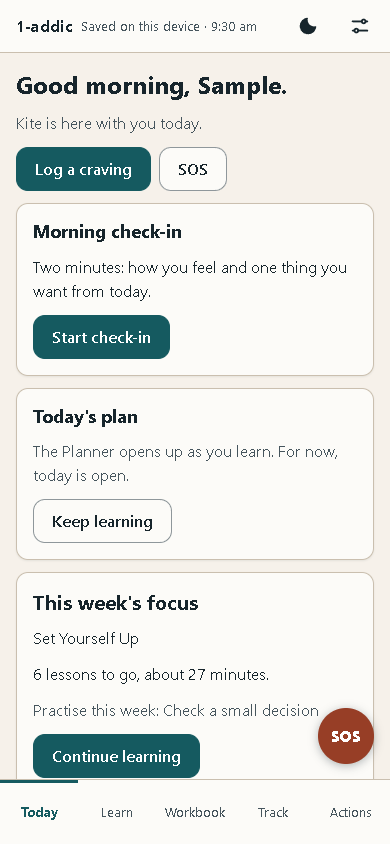

> [!TIP]
> Sample data is only offered on a fresh notebook. Once you have your own profile, the app will not load the sample over it.

## Lesson 2 — Set up

Go through onboarding for real: region, reasons, a Safety Net and the PIN choice.

1. Open the file on a fresh notebook. The welcome shows **Step 1 of 8** at the top.
2. Read the early-access notice and tap **Got it**, then **Next**.
3. On each step, fill in what you want and tap **Next**, or tap **Skip** to leave it for later. You will pick your region (it decides which urgent-help numbers SOS shows), write a few quick reasons, and add a person you could call if you want to.
4. When the PIN step comes, choose. A PIN is offered, never forced. You can set one later in Settings (Lesson 14).
5. At the end you land on **Today**. The round **SOS** button was there the whole time, on every step.

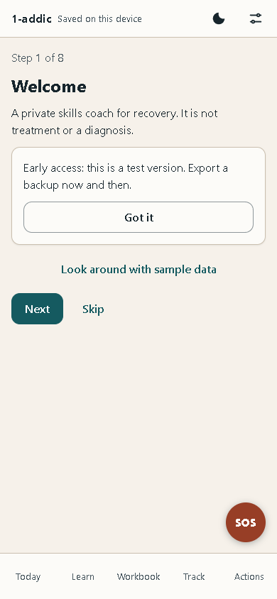

## Lesson 3 — SOS: a craving

Use SOS to rate a craving, pick a tool, wait it out and see how it changed.

1. Tap the round **SOS** button, or **SOS** on Today. The SOS screen opens with **Urgent help** at the very top.
2. Tap **I'm craving**. A 15-minute timer starts at once.
3. Under **How strong is it?**, tap a number from 0 to 10, or tap **Skip**.
4. Follow the tool it offers, such as **Ride the wave**. Tap **Read aloud** to hear it in your device's own voice, and **Next** to move on. Tools such as **Remind me why** show your own reasons, and **Call someone** shows your Safety Nets.
5. When the tool ends, you are asked **How strong is it now?** Tap a number, then choose **It passed** or **Still strong: wait 15 more**.
6. Whatever you choose, the craving goes in your log, so Insights can learn what helps you.

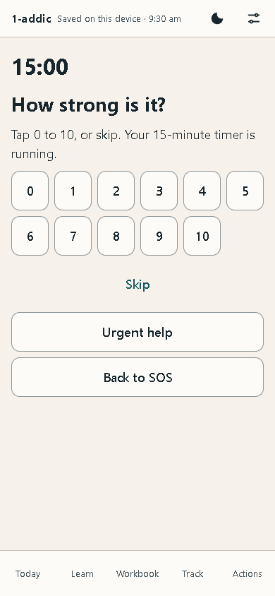

> [!TIP]
> To practise before you need it, use the practice run of SOS offered in the **Start Here** module in Learn. A banner says "Practice drill. Nothing goes in your log", and it does not.

## Lesson 4 — SOS: a hard feeling and a slip

<!-- clinicalReview: true -->

Use SOS for a strong feeling, and see what happens (and what does not) after a slip.

1. Open **SOS** and tap **A hard feeling**.
2. Under **What are you feeling?**, pick the closest one, such as **Anxious or stressed** or **Lonely**, and follow the short steps it offers.
3. Go back to SOS and tap **I slipped**. The screen says a slip is not a failure, and that everything you earned stays.
4. Tap **Log it and go on** to note it, or **Just reading** to leave without logging anything.
5. Look at Today and Learn afterwards. Your lessons, Workbook pages, badges and total days are all still there. Only the optional current run starts again.
6. **Urgent help** is on every SOS screen. It shows the numbers for your region, each marked "please verify".

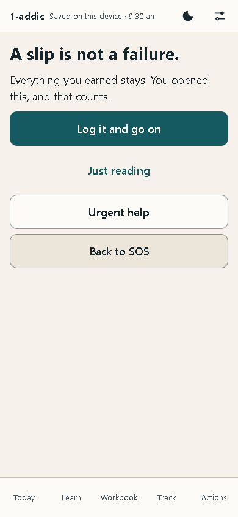

## Lesson 5 — Quick log and check-in

Log a craving in a few taps and do an evening check-in.

1. On **Today**, tap **Log a craving**. (On **Track**, the **+ Log** button offers the same log, and also a feeling, a check-in, an activity or a slip.)
2. Move the slider to how strong the craving was, from 0 (none) to 10 (the strongest).
3. Under **What set it off?**, tap any that fit, such as **Stress** or **Loneliness**, and tap **Save**.
4. For the evening check-in, open **Track**, tap **+ Log**, then **Check-in**, and make sure **Evening** is picked.
5. Set **Mood right now**, **Worry or stress** and **Strongest craving today**, and tap **Save**.
6. Both now show at the top of your log in **Track**.

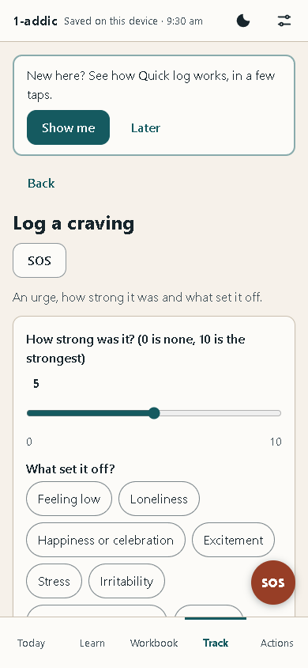

## Lesson 6 — Learn a module

Take one lesson from start to finish and keep the page it makes.

1. Open **Learn**. The **Map** shows your journey: eleven stops. Start anywhere; nothing is locked.
2. Tap the first stop, **Start Here**. You see its lessons, how long each takes, and a **Checkpoint** at the end.
3. Tap a lesson. It moves one short card at a time (**Step 1 of 8**). Tap **Listen** to hear a card, and **Next** to go on.
4. When a lesson asks you to write, such as **Three quick reasons**, type in your own words. What you write is kept as a page in your Workbook.
5. On the last card, tap **Finish lesson**.
6. Open **SOS → I'm craving** and use **Remind me why**: the reasons you just wrote are there.

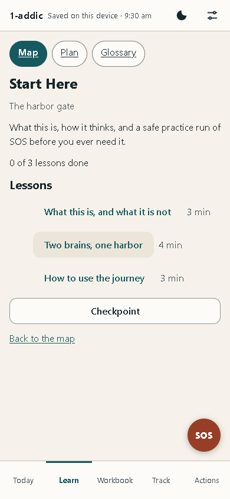

## Lesson 7 — The Workbook

Find, edit and print a page you made.

1. Open **Workbook**. **My Recovery Plan** is at the top, and below it your pages in groups, such as **My Why**.
2. Each page says whether it holds anything yet, for example "Empty for now" or "Nothing saved here yet".
3. Tap **My Reasons Card**. It gathers the reasons from Lesson 6 in one place. **Big view** shows them large, the way SOS does.
4. To change them, open the exercise that made the page (on an empty card, **Write my reasons**), change or add a line, and save. The change shows in SOS straight away.
5. Open any page that holds something, such as **Pros and cons**, and tap **Print** to print it or save it as a PDF.

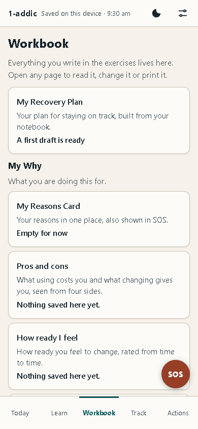

## Lesson 8 — Track and Insights

Read your logs and the patterns the app finds in them.

1. Open **Track**. **Your log** lists everything you logged, newest first, grouped by day.
2. Each row shows the time, the kind of log and a short summary, such as a mood out of 10.
3. Above the log, a line tells you how many logs you have. Insights appear after seven of your own logs.
4. Once you have seven, open **Insights**. You see charts such as **Craving strength by week** and **What set cravings off most**.
5. Read them lightly. With only a few logs, the app says so under each chart. These are patterns to notice, not rules.

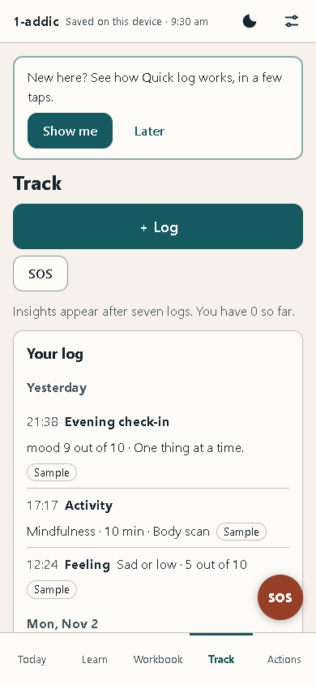

## Lesson 9 — The planner and Battle Plans

Plan a day and attach a Battle Plan to a risky time.

1. Open **Actions**, then **Planner**. It shows one day; use **Previous day** and **Next day** to move.
2. Tap **Add a block**, or **Add here** next to a stretch of open time, and give the block a name and a time.
3. Go back to Actions and open **Battle Plans**. Tap **New Battle Plan**.
4. Fill in **What is the time or place?**, **What I will do**, and any backups (one per line). The other boxes, such as what makes it risky, are optional.
5. Tap **Save the plan**. It shows under **Coming up**. Tap **Change** to edit it, or **Add to calendar** to save a calendar file for that time.

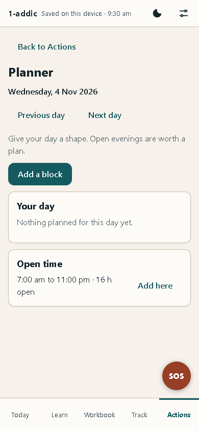

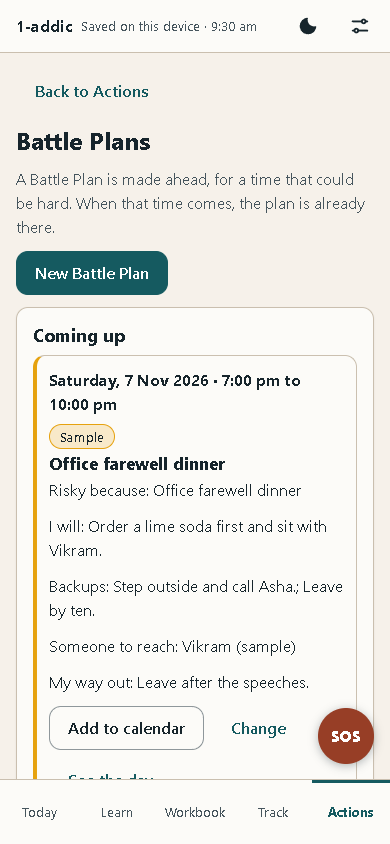

## Lesson 10 — The Weekly Review

Look back at the week in five short screens.

1. Open **Actions**, then **Weekly Review**, and tap **Start the review**.
2. Screen 1, **The last seven days**: read what the week's log shows. A quiet week is fine.
3. Screen 2, **The forecast check**: see how the times you planned for went. Just notice.
4. Screen 3, **Where you are now**.
5. Screen 4, **The week ahead**: is any time coming up that could be hard? You can make a Battle Plan for it now.
6. Screen 5, **Want-tos and a focus**: up to three things you want to do this week, each with a small reward after. Then finish. Nothing in the review is scored.

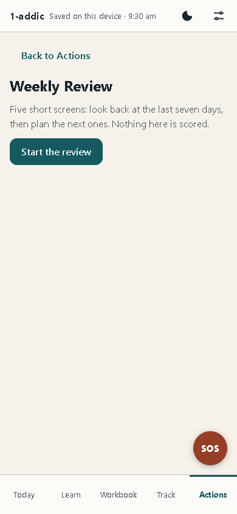

## Lesson 11 — My Recovery Plan

See your best skills, signs and people on one page, and print it.

1. Open **Workbook** and tap **My Recovery Plan**.
2. The first time, it is a draft built from your own notebook. Nothing is saved until you tap **Save**.
3. Read each part, such as **Why I am doing this** and **What keeps me well**. Use **Add a line** to add your own, and tick **This is still right for me** when a part fits.
4. Tap **Save**. Later, **Refresh from my data** brings in what you have added since.
5. Tap **Print** to keep a copy on paper.

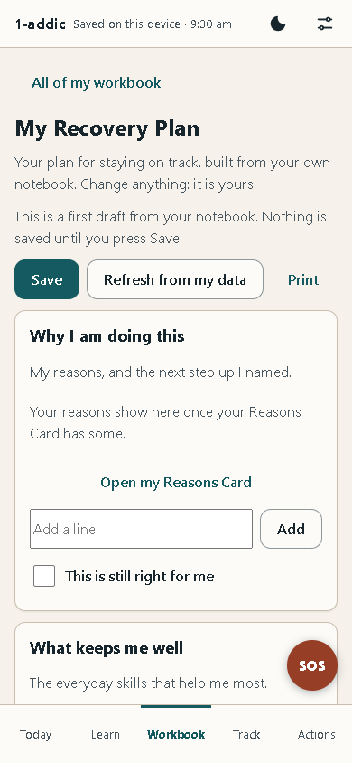

## Lesson 12 — Back up and restore

Export a backup, erase the app, and bring everything back from the file.

1. Open Settings (the sliders) and tap the **Your data** tab.
2. Under **Backup**, tap **Save a backup file**. If you set a PIN, the app asks for it first. Keep the file somewhere private: the file itself is not locked by your PIN.
3. To practise a restore, scroll to **Erase everything** and tap it. Read the question and confirm.
4. Under **Bring back a backup**, tap **Choose a backup file** and pick the file you saved.
5. Confirm **Bring back this backup?**. Everything on this device is replaced by what is in the file.
6. Look around: your logs, pages and plans are all back.

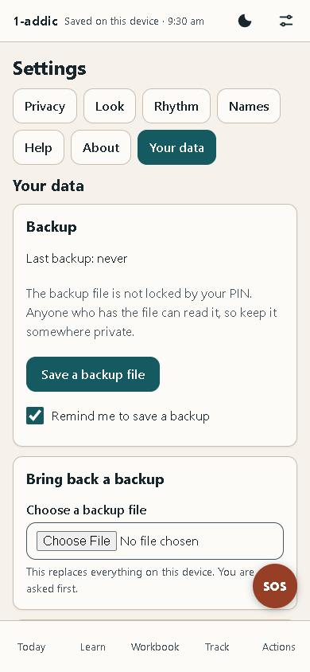

## Lesson 13 — Use it on a phone

Copy the file to a phone, open it, and move your data across.

1. On the computer, save a backup file (Lesson 12).
2. Copy `1-addic.html` and the backup file to the phone's **Download** folder, with a cable or in any way you trust.
3. On the phone, open Chrome and type `file:///sdcard/Download/1-addic.html` in the address bar. (Some Files apps can open it directly too.)
4. Skip onboarding, open Settings → **Your data**, and bring back the backup file.
5. The same screens now fit the phone: the tabs along the bottom, and SOS in the corner.

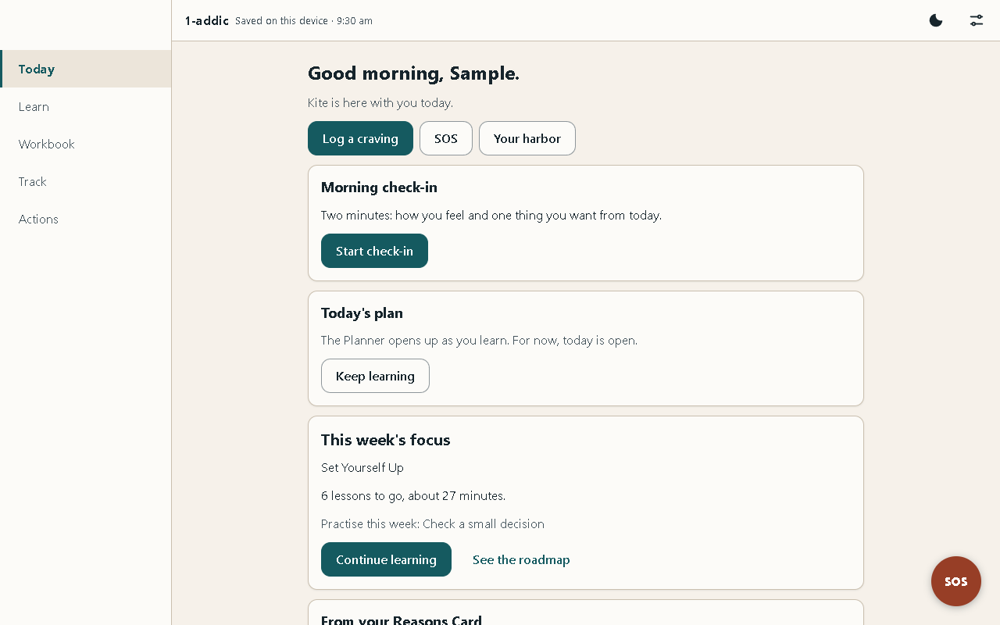

## Lesson 14 — Lock and discreet mode

Set a PIN, lock the app, and make it look like a plain notebook.

1. Open Settings and tap the **Privacy** tab.
2. Tap **Set a PIN**. Type it under **New PIN** and again under **New PIN again**, then tap **Set PIN**.
3. Tap **Lock now**. The lock screen asks for your PIN. SOS still works here, without the PIN.
4. Type your PIN and tap **Unlock**.
5. Back in **Privacy**, tick **Discreet mode**. The app now calls itself "Notebook", the SOS button says "Help", and day counters are hidden.
6. Lock again to see it: "Notebook" at the top, with **Help** and **Breathe**, which both work without the PIN.

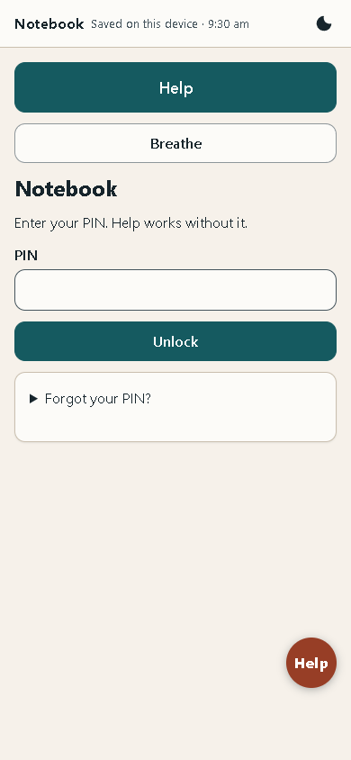

> [!WARNING]
> A forgotten PIN cannot be recovered. Keep a recent backup (Lesson 12), so that erasing and restoring is always an option.

## Lesson 15 — Your Harbor

See where you stand, what changed since you last looked, and one small next step.

1. On **Today**, tap **Your harbor**, next to **Log a craving** and **SOS**. You can also tap the harbor picture on Today. **Your Harbor** opens. The round **SOS** button stays in the corner, and the page has its own **SOS** button at the top.
2. **What just changed** comes first. On your first visit it says "Here is where you stand." After you log something, use a skill or finish a lesson, it lists what grew since your last look.
3. The picture shows your harbor. Each place stands for a group of skills: **The Lighthouse** for thinking clearly, **The Cove** for calm, **The Garden** for joy, **The Pier** for people, and a few more. Below the picture, each place has a button with its level out of 5. Tap one to see its skills and how many more uses take it to the next level.
4. **Where you stand** shows your rank, your XP and your badges. **Next small step** offers one thing to do next, such as a lesson.
5. **Your last 14 days** marks each day you did something for your recovery with a filled dot. An empty day is just empty: nothing is taken away.
6. **What to watch** lists a few patterns from your own logs that may be worth a look, each with a plan.

A slip never dims a place. Levels only go up, because they count the skills you have used, and that never un-happens. With reduced motion on, on your device or in Settings, the harbor stays still. In Calm mode and in discreet mode the picture is left out, and the list of places still shows.

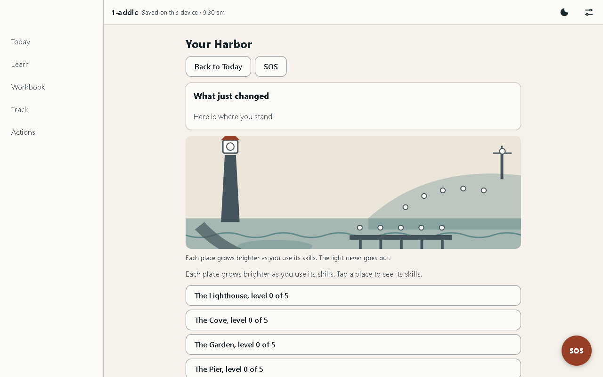

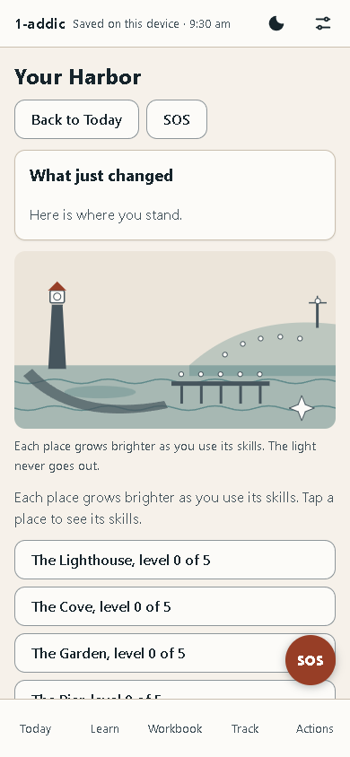

## Lesson 16 — Your day: objectives, days shown up and Your way

Three small things to do each day, a count of the days you showed up, and a path of steps that opens parts of the app early.

1. On **Today**, under the check-in, **Today's objectives** lists three small things for today, such as *Take a short walk* or *Try one exercise*. Tap **Done** when you have done one. Some are marked done for you when you do the matching thing in the app, such as finishing a lesson.
2. Not right for today? Tap **Swap** on one of them to get another. You can swap once a day.
3. The first objective you finish on a day adds one thing to your harbor, such as a lantern, a tree or a boat. It stays there. A day with nothing done adds nothing and takes nothing away. Tap **Your harbor** to see what has grown.
4. Under the buttons at the top of Today, **Days shown up** shows three numbers: **Now** (days in a row), **Best** (your longest run) and **In all** (every day you showed up). A day counts when you log something, finish a lesson, do a practice, finish an objective or do the SOS practice drill. Sober days are not part of it: they are counted on their own, and only if you turn them on.
5. Missing one day in a week keeps your run going, and the line says so. Miss more and a new run starts the next time you show up, with the words "You came back." **Best** and **In all** never go down.
6. **Your way** is a path of steps, one at a time. The card on Today shows the step you are on, what it asks, what it opens (the first step, the SOS practice drill, opens the Support Network) and how far along you are. When the step is done, tap **Claim**. What it opens is ready straight away.
7. On **Your harbor**, **Your way** lists every step: the one you are on now, the ones done, and the ones for later.

Nothing here is ever taken back. SOS, urgent help, the lessons, Settings and your data are never part of the path: they are always open.

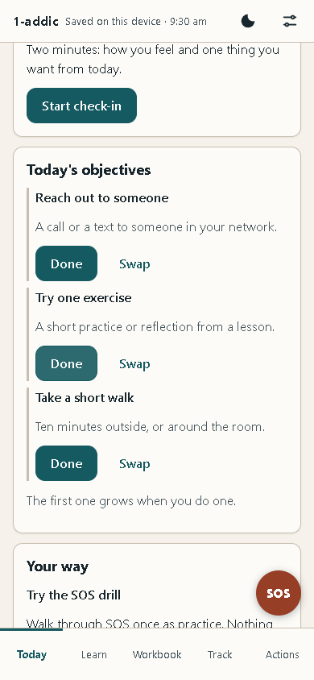

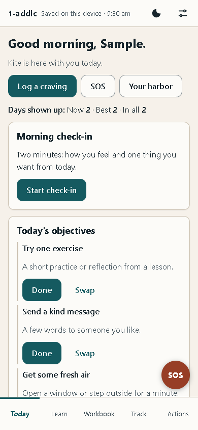

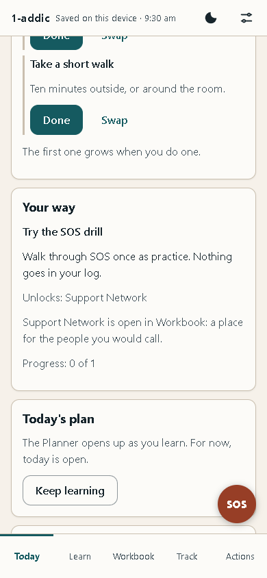

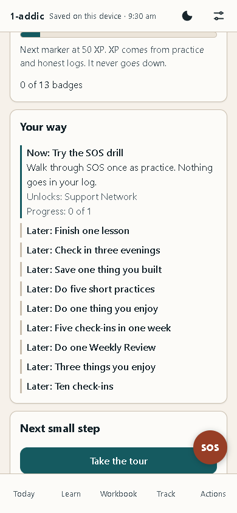

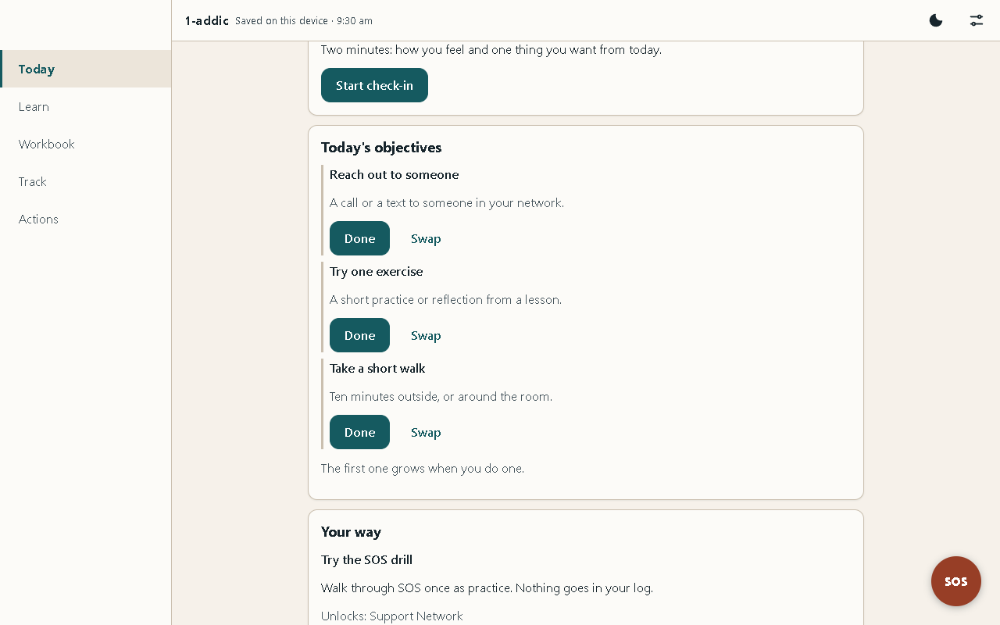

<!-- pagebreak -->

# Part 4 — Help

## Troubleshooting

| What you see | Why | What to do |
|---|---|---|
| The top bar says "Not saved — export before closing" | The browser is blocking storage, often in a private window. Your data lives only in memory and is lost when the tab closes | Export a backup now. Then open the file in a normal browser window and import it |
| The top bar says "Saved (fallback)" | The main storage was not available, so a simpler one is used | Your data is kept, but export backups often and open the file in a normal Chrome window when you can |
| The Files app will not open the file on a phone | Some Files apps do not hand local pages to the browser | Open Chrome and type `file:///sdcard/Download/1-addic.html` |
| My data is gone after opening the file | A different browser, a different folder, a private window, or the browser's data was cleared | Open the file from the same place in the same browser, or import your latest backup (Lesson 12) |
| I forgot my PIN | The PIN cannot be recovered; that is what keeps your data private | Erase the app and import your latest backup. SOS works the whole time |
| An urgent-help number does not connect | Numbers change, and each one is marked "please verify" | Call your local emergency number |
| Load sample data does nothing but show a note | Sample data is only for a fresh notebook, and this one already holds your own profile | Nothing is wrong. Your own entries are kept as they are |
| A screen says "coming soon" or is locked | That part is not built yet in this version | It will say what it will be. Nothing is broken; the rest works |

## Known quirks

None of these lose data. They are rough edges to be aware of in this early version.

| Quirk | Effect | Status |
|---|---|---|
| Some screens are not finished | A screen that is not ready shows "coming soon", a stub with one real action, or a locked card. Never a button that does nothing | Info |
| One browser, one device | Data does not follow you between browsers or devices on its own. Use export and import | Info |
| Urgent-help numbers unverified | Every number shows "please verify" until the owner has checked it | Warn |
| Read-aloud voice | Read-aloud uses your device's own voice, so it sounds different on each phone, and some devices have none | Info |
| The backup file is not locked | Anyone who has the file can read it, even with a PIN set | Warn |

## How this guide was checked

The steps in Part 3 were written against the screens of the real file, and every picture was taken from that file by the screenshot script (`npm run screens`) on 8 November 2026. Two kinds of checks are run on the same file.

- **Logic checks** (`npm test`) run the app's engine and data layer directly: nothing derived ever goes down after a slip, an SOS drill writes nothing, a backup restores every record, and a wrong PIN opens nothing. On 9 November 2026, **763 of 763** logic checks passed, in 16 test files.
- **Real-browser checks** (`npm run test:browser`) open the file in Chrome, offline, at phone size, and use the screens by tapping and typing. On 9 November 2026 there were **32** of them. In one full run **all 32 passed**.

| Area | What is checked | Status |
|---|---|---|
| Opening | Opens from a plain file with no console errors and no network requests; the first screen draws within its time budget | Pass |
| Colours | Text and buttons meet the contrast minimum in the light and dark themes | Pass |
| Getting around | The five tabs open by link and Back works; no sideways scrolling at phone width | Pass |
| First run | Onboarding all the way through, and Skip; the guided tour, its Skip, and replaying it from Settings | Pass |
| SOS | Reachable before onboarding and on the lock screen, never gated | Pass |
| SOS craving and drill | The craving flow with the timer and both outcomes; a drill saves nothing | Pass |
| Logging | A quick log and an evening check-in are saved | Pass |
| Your Harbor | Opens from Today in one tap with SOS still there; shows what changed after a quick log; a slip lowers no place; nothing moves under reduced motion | Pass |
| Your day | An objective done grows the harbor by one; after missed days the best run and the total never drop; a claimed step of Your way opens its feature | Pass |
| Learning | A lesson's page in the Workbook, then shown in SOS | Pass |
| Privacy | A PIN locks and unlocks; saving a backup asks for it; the discreet lock screen shows "Notebook" and Help | Pass |
| Settings | A PIN is set and removed from Settings → Privacy; a wrong PIN removes nothing | Pass |
| Planning | A block added to the Planner is still there after leaving the page | Pass |
| Backup | Export, erase and import bring back every record | Pass |
| Looks | The dark theme applies and stays; the print view of the plan; the saved label always shows | Pass |

Every row passed in the browser on 8 November 2026. The logic checks cover the same ground underneath.

### The privacy proof

The file carries a **Content-Security-Policy**^[A rule written into the file that tells the browser what the page may load or send. Here it says: nothing from the network, ever.] that forbids every network request. The browser checks fail if the page makes any request at all, other than to the file itself; on 8 November 2026 the page made none. There are no trackers, no analytics, no ads and no account.

> [!NEXT]
> **A simple routine that keeps 1-addic useful.** *Every morning and evening:* a one-minute check-in. *When a craving or a strong feeling comes:* a quick log, or SOS if it is hard. *Three times a week:* one lesson or one Workbook page. *Once a week:* the Weekly Review, then Settings → Your data → save a backup file, and keep the file somewhere safe. *Once a month:* read your Reasons Card and My Recovery Plan, and change anything that no longer fits.
